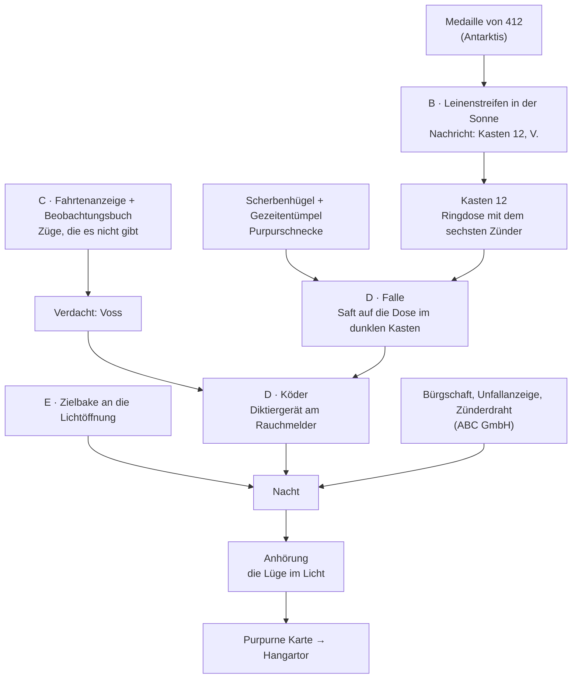

# Kyphi – Area 52

## Hintergrund

Eine Felseninsel im Atlantik. Nach außen ist sie ein Vogelschutzgebiet mit Betretungsverbot und einem stillgelegten
Leuchtturm; ihr einziger offizieller Bewohner ist der Vogelwart. In der Antike wurde hier Purpur gemacht: In der
Bucht liegen Hügel aus aufgeschlagenen Schneckenschalen und in den Fels gehauene Becken. Daher hat der höchste
Grad der Sekte seine Farbe.

Von hier steuert die Sekte ihre 50.000 Satelliten. Jeder trägt einen entfaltbaren Spiegel. Ein paar Hundert
davon machen eine Nacht taghell, alle zusammen verglasen Fels. Auf der Insel heißt das nur „das Licht“.

- **Oberirdisch:** Leuchtturm mit Leitstand, Gästehaus, Saal, Vogelwarte. Zugang mit der schwarzen Karte; der
  Posten am Bahnhof sieht nur auf die Farbe, einen Kartenleser gibt es nicht.
- **Unter der Insel:** Teil 3 (`concept/part_3.md`). Das Hangartor im Fels hat einen Kartenleser und öffnet
  nur mit der purpurnen Karte.

Novizen führt die Sekte nur als Nummern: Die Karte trägt weder Namen noch Foto, die Listen kennen keine Gesichter.
Deshalb zweifelt auf der Insel niemand daran, dass Martin 666 ist.

Running Gag: Warum „52“? Posten: „Weil bei 51 alle hinsehen.“

## Story in Kürze: „Purpur lügt nicht“

Area 52 ist der letzte Ort von Teil 2. Hier laufen die Fäden aus der Antarktis (412, der angesägte Läufer) und
der ABC GmbH (die gesprengte Firste) zusammen.

Martin kommt, um einen Weg zur purpurnen Karte zu finden, und stellt fest, dass er erwartet wird: Im Gästehaus
hängt eine **Vorladung** für „Novize 666“. Die Revisorin der Sekte, Dr. Voss, untersucht den Tod von 412 und den
Einsturz von Stollen 7, und 666 ist ihr Täter. Die Anhörung ist bei erstem Licht. Martin hat einen Tag und eine
Nacht.

**Wendung 1:** Niemand hält Martin hier für einen Fremden. Man hält ihn für den Saboteur.

**Wendung 2:** Die Revisorin hat beides selbst getan. Ein Sitz im Kollegium ist frei, und er geht an den, der
einen großen Fall löst. Also hat sie sich einen gemacht. Tote kann man nicht anhören, deshalb reicht ihr 412 als
Täter nicht: Sie braucht einen lebenden. Dann fährt nach 26 Monaten die Karte 666 wieder, ausgerechnet in die
Antarktis und zur ABC GmbH.

**Wendung 3:** Im Saal gilt ein altes Recht. Wer im Licht lügt, verliert Rang und Karte an den, der ihn überführt.
Martin muss der Revisorin keine Morde nachweisen, nur eine einzige Lüge. Er überführt sie mit der Farbe ihres
eigenen Rangs: Ihre Hand wird vor allen purpurn.

**Wendung 4 (Schluss):** Das Kollegium gibt ihm die purpurne Karte und lädt ihn nach unten ein. Es weiß längst,
was er alles in Ordnung gebracht hat, und es hat dort unten etwas, das in Ordnung gebracht werden muss. Als der
Saal leer ist, nennt die Stimme ihn beim Namen. Sie weiß, wer er ist, und Martin erkennt sie: Es ist die ältere
Stimme von seiner Aufnahme aus Teil 1.

## Vorgeschichte: was wirklich geschah

| Wann | Was |
|---|---|
| Letzter Sommer | Novize 412 (Feddersen nennt ihn Mats) hilft einen Sommer lang in der Vogelwarte. Er lernt dort, Wäsche mit Schneckensaft zu zeichnen. |
| 10. des Vormonats | Voss schickt 412 zur ABC GmbH: sechs Zünder Stufe 0 (Eintrag im Sprengstoffbuch). Er gibt ihr fünf und sagt, einer sei feucht geworden. Den sechsten versteckt er in Nistkasten 12 und schreibt eine Nachricht in seine Medaille. Am nächsten Morgen wird er in die Antarktis versetzt. |
| Nacht zum 9. | Voss fährt ungebucht in die Antarktis und sägt die Feder an 412s Steigschutzläufer an. Am Morgen steigt er auf die Antenne. |
| Nacht zum 21. | Voss fährt ungebucht zur ABC GmbH und setzt fünf Ladungen in die Firste von Stollen 7. Drei zünden zur Frühschicht, zwei, als Brenner eingefahren ist. |
| danach | Voss eröffnet die Untersuchung. Ihr fehlt ein lebender Täter. |
| vor wenigen Tagen | Die Karte 666 fährt zum ersten Mal seit 26 Monaten. Voss lädt 666 vor. |
| heute (der 2.) | Martin kommt an. |

Züge der Revision werden nicht gebucht. Deshalb steht für beide Nächte nichts auf der Fahrtenanzeige.

## Figuren

**Dr. Voss, Revisorin** (purpur). Höflich, schnell, nie laut. Sitzt im Gästehaus über ihren Akten, als gehöre ihr
das Haus. Prüft seit Jahren andere; dass jemand sie prüfen könnte, kommt ihr nicht in den Sinn. Genau daran
scheitert sie.

> Voss: „666. Sechsundzwanzig Monate keine Fahrt, kein Beitrag. Und dann in einer Woche die Antarktis und
> Stollen 7. Sie tauchen auf, wo etwas kaputtgeht.“  
> Martin: „Oder wo etwas wieder ganz wird.“  
> Voss: „Das klären wir morgen. Im Licht.“

**Feddersen, Vogelwart** (schwarz). Seit vierzig Jahren auf der Insel. „Ich war vor denen hier. Die haben die
Insel gekauft und mich gleich mit. Die Karte liegt in der Keksdose.“ Zählt Vögel, schreibt alles auf, glaubt an
nichts außer an sein Beobachtungsbuch. Seine Finger sind purpurn gefleckt: Er zeichnet seine Wäsche mit
Schneckensaft, wie seine Großmutter. 412 nennt er Mats, den Jungen. Redet wenig, bis Martin ihm die Nachricht des
Jungen zeigt.

**Malin, Schichtleiterin im Leitstand** (schwarz). Jung, stolz auf ihre Arbeit, rechnet Bahnen und fragt nicht,
wofür. Nennt die Satelliten „die Herde“.

**Der Posten** am Bahnhof. Sieht den ganzen Tag schwarze Karten und sonst nichts.

**Die Stimme.** Das Kollegium sitzt unten und ist im Saal nur über ein Sprechgitter zu hören. Eine ruhige, ältere
Stimme: dieselbe, die auf Martins Aufnahme aus Teil 1 von Hollmanns Kiste spricht (Sprecher `elder`). Durch das
Gitter klingt sie blechern, und sie spricht für das ganze Kollegium. Martin erkennt sie erst, als sie am Schluss
mit ihm allein redet. Sie weiß als Einzige, dass 666 der Restaurator Martin Kessler ist; das übrige Kollegium hält
ihn für den Novizen. Wer sie ist, zeigt Teil 3.

**Zwei Anwärter** (grau) im Gästehaus. Sie warten seit Tagen auf ihre Prüfung zum schwarzen Grad; die nimmt die
Revision ab, und die hat gerade anderes zu tun. Die eine lernt die Saalordnung auswendig, der andere weiß allen
Klatsch der Insel. Von 666 rücken sie ab, sobald sie die Nummer hören („Der mit der Vorladung? Wir kennen Sie
nicht.“).

> Anwärter: „Im Kollegium ist seit einem halben Jahr ein Sitz frei. Er geht an den, der einen großen Fall löst.
> Raten Sie, wer seit einem halben Jahr keinen kleinen mehr anfasst.“  
> Anwärterin: „Pst. Der Melder.“  
> Anwärter: „Ich sage ja nichts. Ich sage nur, dass sie noch nie einen Fall verloren hat.“

> Anwärterin: „Regel drei kennt jeder. Durchgefallen wird an Regel vier. Wer anklagt und nichts in der Hand hat,
> geht ohne Karte nach Hause.“

So erfährt der Spieler vor der Anhörung, was Voss antreibt, dass im Gästehaus mitgehört wird und dass eine
Anklage ohne Beweis gefährlicher ist als Schweigen.

**Zuhörer** bei der Anhörung: Feddersen, Malin, der Posten, die beiden Anwärter.

## Die Saalordnung

Sie steht auf einer Steintafel im Saal und ist die Spielregel des Ortes:

1. Gesprochen wird im Licht, die Hand auf dem Stein.
2. Ein Novize hat keine Stimme, es sei denn, ein Purpurträger leiht ihm seine.
3. Wer im Licht lügt, verliert Rang und Karte an den, der ihn überführt.
4. Wer ohne Beweis anklagt, verliert den eigenen Rang.

> Martin: „Regel drei ist interessant. Regel vier weniger.“

## Was Martin mitbringt

| Gegenstand | Woher | Wofür |
|---|---|---|
| Schwarze Karte | Innenerde | am Posten vorbei |
| Medaille von 412 (gesprungen) | Antarktis, Aufstieg | enthält 412s Nachricht |
| Bürgschaft von Brenner | ABC GmbH, Brenners Büro | Regel 2: Brenner leiht Martin seine Stimme |
| Unfallanzeige | ABC GmbH, Siebert | Anhörung: Martin kam als Retter, nach dem Einsturz |
| Zünderdraht mit Stufenschild | ABC GmbH, Kammer in Stollen 7 | Anhörung: Die Firste wurde gesprengt |
| Spatel, Pinzette, UV-Lampe, Diktiergerät | Teil 1 | Medaille öffnen, Schnecke, Köder |
| Bürgschaft von Pjotr | Antarktis | ungültig: „Schwarz leiht keine Stimme.“ |

Area 52 ist also erst lösbar, wenn Antarktis, Innenerde und ABC GmbH abgeschlossen sind. Betreten und erkunden
kann Martin die Insel schon mit der schwarzen Karte allein.

## Räume: was dort ist und was dort geschieht

### 1. Bahnhof im Fels

Die Bahn hält in einer Felswand über dem Meer. Zum ersten Mal seit dem Museum fällt Tageslicht herein.

| Objekt | Aktion |
|---|---|
| Zug in der Schleuse | Ein- und Aussteigen. Bei der ersten Ankunft fliegen draußen Hunderte Seeschwalben auf (kurze Sequenz). |
| Posten im Glaskasten | Reden. Sieht auf die Karte: „Schwarz. Weiter. – 666? Für Sie hängt was im Gästehaus.“ Später: Frage nach Zügen ohne Eintrag. |
| Fahrtenanzeige | Vollbild: alle Fahrten der letzten 60 Tage mit Datum, Uhrzeit und Kartennummer. Letzte Zeile: „14:10 an 666“. |
| Ausgang | Klippenweg |

### 2. Klippenweg (scrollend)

Der Weg über das Plateau, von dem alle anderen Orte abgehen.

| Objekt | Aktion |
|---|---|
| Seeschwalbenkolonie am Hang | Ansehen. |
| Mauer mit Nistkästen 1–20 (Sturmschwalben) | Ansehen. Kasten 12: erst zugänglich, wenn Feddersen ihn geöffnet hat. |
| Lichtöffnung des Saals | Eine runde, gemauerte Brüstung im Boden. Ansehen: „Unten steht ein Stein im Halbdunkel.“ Zielbake benutzen. |
| Hangartor im Fels, Personentür mit Kartenleser | Ohne purpurne Karte: „Hier besteht meine Karte nicht einmal die Sichtprüfung.“ Mit purpurner Karte: Teil 3. |
| Wege | Bahnhof, Purpurbucht (Treppe), Vogelwarte, Gästehaus, Saal (Treppe hinab), Leuchtturm |

### 3. Purpurbucht

| Objekt | Aktion |
|---|---|
| Scherbenhügel | Ansehen: „Tausende Schalen. Alle von einer Sorte, alle an derselben Stelle aufgeschlagen.“ Schalenscherbe nehmen. |
| Becken im Fels | Ansehen: flache, in den Stein gehauene Wannen, am Rand dunkel verfärbt. |
| Gezeitentümpel | Ansehen: „Dutzende Schnecken und Muscheln. Ich weiß nicht, welche.“ Siehe Rätsel „Die richtige Schnecke“. |
| Übungsfeld | Ein Kreis aus glasigem Fels, zehn Meter breit. Martin: „Verglast. Dafür braucht man weit über tausend Grad.“ |
| Zielbake auf Dreibein | Ansehen: ein Kasten mit Tragegriff, Schild „Ziel Probe“. Nehmen (erst sinnvoll nach dem Leitstand). |

### 4. Vogelwarte

Außen: Hütte, Bank, Wäscheleine in der Sonne.

| Objekt | Aktion |
|---|---|
| Feddersen | Reden, Gegenstände zeigen. |
| Beobachtungsbuch auf der Bank | Vollbild: Vierzig Jahre Einträge, jeden Tag mit Uhrzeit. Spalte „Störung: Kolonie fliegt auf“, am Rand: „Ursache? Die Falken sind es nicht.“ |
| Spektiv | Durchsehen: die Kolonie. Kulisse. |
| Wäscheleine | Ansehen: „Jedes Stück hat ein F. Auf dem nassen Hemd ist es grün, daneben blau, auf den trockenen purpurn.“ Leinenstreifen benutzen. |
| Eimer | Ansehen: leer. „Stinkt nach Knoblauch.“ |

### 5. Gästehaus

Das alte Haus des Leuchtturmwärters.

| Objekt | Aktion |
|---|---|
| Aushang | Vollbild: die Vorladung (siehe unten). |
| Schlüsselbrett | Schlüssel zu Zimmer 6 nehmen. |
| Dr. Voss am Tisch, Akten, Teetasse | Reden. |
| Zwei Anwärter am Frühstückstisch | Reden: der freie Sitz im Kollegium, die Regeln, der Melder (siehe Figuren). |
| Hausordnung | Ansehen: „Rauchen verboten. Die Melder sind sehr empfindlich.“ |
| Tür | Zimmer 6 |

Die Vorladung:

> „Novize 666 wird gehört in Sachen: Absturz des Novizen 412 (Antarktis, am 9.) und Einsturz Stollen 7 (ABC GmbH,
> am 21.). Anhörung im Saal bei erstem Licht nach Ihrer Ankunft. Zimmer 6 ist gerichtet. – Die Revision, Dr. Voss“

### 6. Zimmer 6

| Objekt | Aktion |
|---|---|
| Bett | Benutzen: die Nacht beginnt, sobald alles vorbereitet ist (siehe „Die Nacht“). |
| Rauchmelder | Ansehen: „Ein Rauchmelder. Der hat ein Loch zu viel.“ Kreppband benutzen: Martin weigert sich. Diktiergerät im Zimmer benutzen: siehe „Der Köder“. |
| Fenster | Ansehen: der Leuchtturm. |

### 7. Saal des Lichts

Eine antike Zisterne, rund, tief im Fels. Licht kommt nur durch die Öffnung in der Decke.

| Objekt | Aktion |
|---|---|
| Lichtstein in der Mitte | Zwei Mulden für die Hand, eine für den Ankläger, eine für den Angeklagten. |
| Steintafel | Vollbild: die Saalordnung. |
| Sprechgitter | Ansehen. Bei der Anhörung: die Stimme. |
| Bänke | Kulisse, bei der Anhörung besetzt. |

### 8. Leitstand

Oben im Leuchtturm, wo früher die Lampe stand.

| Objekt | Aktion |
|---|---|
| Malin | Reden. |
| Wandanzeige | Ansehen: die Erde und 50.000 Punkte. |
| Tafel „Tage ohne Kessler-Ereignis: 1.204“ | Ansehen, Malin fragen (siehe unten). |
| Lichtplan | Ansehen: „Heute: Probe bei erstem Licht. 200 Spiegel. Ziel: Bake.“ |
| Alte Leuchtfeuerlinse, Vorhang davor | Ansehen. Malin: „Tagsüber bleibt der Vorhang zu. Sonst brennt uns die Sonne durch die Linse die Bude ab.“ Kulisse. |

> Martin: „Kessler-Ereignis?“  
> Malin: „Zwei Satelliten stoßen zusammen, die Trümmer treffen die nächsten, und immer so weiter. Am Ende ist der
> Himmel zu. Heißt nach irgendeinem Kessler.“  
> Martin: „Nie gehört.“

Die Tafel ist das Gegenstück zu „Unfallfrei seit 4.012 Tagen“ am Werkstor der ABC GmbH.

## Rätsel

### 1. Was 412 hinterlassen hat

Die Medaille ist eine Kapsel: Jeder Novize trägt darin eine Prise Kyphi.

1. **Medaille ansehen:** „Gesprungen. Und durch den Sprung riecht es nicht nach Kyphi. Eher nach Knoblauch.“
2. **Spatel** in den Sprung: Die Kapsel geht auf. Statt Harz liegt ein aufgerollter **Leinenstreifen** darin.
   „Leer. Ein paar blasse, gelbgrüne Flecken. Wer versteckt ein leeres Stück Stoff?“
3. Fehlversuche, die Martin nur beschreibt:
   - **Feuerzeug:** „Zitronensaft würde jetzt braun. Das hier nicht.“
   - **UV-Lampe:** „Die Flecken werden grün. Langsam. Und dabei bleibt es. Die Lampe ist zu schwach.“
4. **Hinweise** auf der Insel: Der Eimer an der Vogelwarte stinkt genauso nach Knoblauch. An der Wäscheleine sind
   Feddersens Zeichen je nach Trockenzeit grün, blau oder purpurn.
5. **Lösung:** den Leinenstreifen an die **Wäscheleine** in die Sonne hängen. Vollbild: Die Schrift erscheint,
   erst grün, dann blau, dann purpurn.

> „Sechs geholt für V. Fünf gegeben. Der sechste liegt bei der Sturmschwalbe, Kasten 12. Wenn ich falle, war es
> nicht der Wind. – 412“

Die Lösung gibt es nur hier: Alle anderen Orte liegen unter der Erde oder in der Polarnacht.

6. **Feddersen den Streifen zeigen.** Er erkennt die Schrift des Jungen und wird gesprächig. Er öffnet Kasten 12
   selbst („Der Vogel kennt mich.“). Unter dem Nistmaterial liegt eine **Ringdose** („Vogelringe 2,8 mm“), darin
   ein **Zünder** mit Schild: Stufe 0, Los 2291. Dieselbe Nummer wie am Zünderdraht aus Stollen 7.

> Martin: „Der bleibt, wo er ist. In meinem Zimmer wäre er ein Geständnis.“

Offen bleibt: Wer ist V.? Auf der Insel gibt es zwei: Voss und den Vogelwart. Feddersen hat die Schnecken, die
Kästen und purpurne Finger. Das ist die falsche Fährte des Ortes.

### 2. Die Störungen

Feddersen notiert seit vierzig Jahren, wann die Kolonie geschlossen auffliegt, und weiß bis heute nicht, warum.

1. **Fahrtenanzeige** am Bahnhof und **Beobachtungsbuch** an der Vogelwarte ansehen. Martin liest nur vor.
   - Jeder Zug auf der Anzeige hat im Buch zur selben Minute eine Störung, auch Martins Ankunft um 14:10.
   - Im Buch stehen vier Störungen, zu denen es keinen Zug gibt: in der Nacht zum 9. (00:40 und 05:10) und in der
     Nacht zum 21. (01:15) mit dem Vormittag danach (11:50).
   - Die Daten kennt der Spieler aus der Vorladung.
2. **Feddersen:** „Ich weiß, was Ihre Seeschwalben aufscheucht.“ Der Spieler wählt selbst: die Falken, das
   Licht, der Leuchtturm oder **der Zug**. Bei einer falschen Antwort hat Feddersen das längst geprüft.

> Feddersen: „Der Zug. Vierzig Jahre! … Dann fährt bei Ihnen nachts aber einer, den es nicht gibt. Zweimal.“

3. Er schreibt Martin die Einträge ab („Aus dem Buch reiße ich nichts.“): **Abschrift aus dem Beobachtungsbuch**.
4. **Posten** fragen, ob nachts etwas fährt, das nicht auf der Anzeige steht: „Auf der Anzeige steht alles. Bis
   auf die Revision. Die bucht nicht.“

Damit hat Martin einen Verdacht und nichts in der Hand:

> Martin: „Ein Vogelbuch und ein Fetzen Leinen. Damit überführt man keine Revisorin.“

Das Buch ist der einzige Fahrtennachweis, den die Revision nicht kennt und nicht ändern konnte.

### 3. Die richtige Schnecke

Im Gezeitentümpel sitzen Napfschnecken, Strandschnecken, Kreiselschnecken, Miesmuscheln und mehr.

1. Ohne Hinweis: „Ich weiß nicht, welche.“ (Wie bei den Sicherungen im Materiallager.)
2. **Schalenscherbe** vom Scherbenhügel mit dem Tümpel benutzen: „Dicke Schale, Knotenreihen, die Mündung innen
   orangerot. Die da.“ Der Hügel ist der Abfall der antiken Färber, also liegt dort genau die Art, die färbt.
3. Mit bloßer Hand nimmt Martin sie nicht: „Kontamination. Nein. Und die hier färbt.“ Feddersen dazu: „Was die
   anfasst, bleibt purpurn. Fragen Sie meine Finger.“
4. Mit der **Pinzette** nehmen: **Purpurschnecke**. Im Tümpel sitzen genug, sie lässt sich beliebig oft holen.

Feddersen hilft nur so weit: „Unten in den Tümpeln. Ich melke sie und setze sie zurück. Welche? Die, die stinkt.“

### 4. Die Falle in Kasten 12

Das Problem benennt Martin am Kasten:

> Martin: „V. weiß nicht, dass es den sechsten Zünder gibt. Wenn V. ihn holt, ist er weg, und ich kann nie
> beweisen, wer ihn geholt hat.“

Der Spieler kennt inzwischen alle Eigenschaften des Safts: farblos, erst im Licht purpurn, geht nie wieder ab.

1. **Fehlversuch:** Purpurschnecke mit dem Kasten (Deckel, außen) benutzen. Nach ein paar Minuten ist der Deckel
   purpurn. „In der Sonne ist der Saft schneller als jeder Dieb. Jetzt sieht ihn jeder, und abfärben tut er auch
   nicht mehr.“ Feddersen: „Jetzt ist mein Kasten gezeichnet. Passt zum Besitzer.“ Keine Sackgasse.
2. **Lösung:** Purpurschnecke mit der **Ringdose im Kasten** benutzen. Martin drückt mit der Pinzette ein paar
   milchige Tropfen auf die Dose und schließt den Deckel. „Farblos. Solange es dunkel bleibt.“ Den Zünder selbst
   lässt er sauber. Die Schnecke setzt er zurück.

Im dunklen, feuchten Kasten bleibt der Saft unsichtbar. Wer die Dose nachts anfasst, hat ihn an den Fingern und
merkt es erst, wenn Licht darauf fällt.

### 5. Der Köder

> Martin: „Fehlt nur noch, dass V. von Kasten 12 erfährt. Hingehen und es erzählen kann ich schlecht.“

1. **Rauchmelder** in Zimmer 6 ansehen: ein Mikrofon. Die Revision hört mit. (Feddersen: „Im Gästehaus haben die
   Wände Ohren.“)
2. **Kreppband** auf den Melder (die Gewohnheit aus Teil 1): „Diesmal nicht. Wenn der verstummt, steht in zwei
   Minuten jemand in der Tür.“
3. **Lösung:** das **Diktiergerät** im Zimmer benutzen. Martin diktiert Restaurierungsnotizen, das tut er immer,
   und es ist der einzige unverdächtige Grund, in einem leeren Zimmer laut zu reden.

> Martin (diktiert): „Notiz. 412 hat einen sechsten Zünder versteckt. Vogelwarte, Nistkasten 12. Hole ihn morgen
> vor der Anhörung.“

Vorher diktiert Martin nur Belangloses:

- Ohne Verdacht gegen Voss (Rätsel 2): „Ich wüsste nicht, wem ich hier etwas erzählen sollte.“
- Ohne Falle (Rätsel 4): „Wenn ich das jetzt ausplaudere, ist der Zünder morgen weg, und ich habe nichts.“

Der Köder trifft nur die Revision. Kommt nachts niemand, wäre es der andere V. gewesen.

### 6. Licht für den Saal

> Martin (im Saal oder am Bett): „Bei erstem Licht kommt durch das Loch gerade genug, um die eigene Hand zu
> sehen. Purpur wird da nichts.“

Dass schwaches Licht nicht reicht, weiß der Spieler von der UV-Lampe. Feddersen bestätigt es an der Wäscheleine:
„Morgens hänge ich nichts raus. Vor zehn färbt die Sonne nicht.“

1. **Leitstand, Lichtplan:** „Heute: Probe bei erstem Licht. 200 Spiegel. Ziel: Bake.“
2. **Malin:** „Wir zielen nie auf Koordinaten. Immer auf die Bake. Dann kann sich keiner vertippen und eine
   Stadt treffen.“ – „Eine Stadt?“ – „Mit zweihundert wird es nur hell. Wie ein Vormittag. Für mehr braucht man
   Purpur.“ Die Probe läuft bei erstem Licht, weil die Satelliten dann schon in der Sonne stehen und der Boden
   noch nicht.
3. **Purpurbucht:** die **Zielbake** vom Übungsfeld nehmen. „Sie hat einen Tragegriff. Jemand hat damit
   gerechnet, dass man sie umstellt.“
4. **Klippenweg:** die Zielbake an die **Lichtöffnung** des Saals stellen.

> Martin: „Zweihundert Spiegel. Hell wie ein Vormittag, sagt Malin. Hoffentlich hat sie richtig gezählt.“

### Die Nacht

Bett in Zimmer 6 benutzen. Martin legt sich erst hin, wenn alles steht, und nennt sonst, was fehlt:

| Fehlt | Martin |
|---|---|
| Bürgschaft von Brenner | „Morgen darf ich dort nicht einmal den Mund aufmachen.“ |
| Falle und Köder | „Ich habe nichts gegen V. in der Hand. Wenn ich mich jetzt hinlege, wache ich als Saboteur auf.“ |
| Bake an der Lichtöffnung | „Bei erstem Licht ist es im Saal kaum heller als jetzt hier.“ |

Dann eine Sequenz wie die Nacht in Teil 1: die Uhr, 01:30. Eine Gestalt an der Mauer mit den Nistkästen, ein
Deckel, eine Sturmschwalbe flattert davon. Die Dose fliegt über die Klippe. Dann eine Glocke: erstes Licht.

### 7. Die Anhörung

Der Saal ist voll und fast dunkel. Voss und Martin stehen am Lichtstein, jeder mit der Hand in seiner Mulde.
Martin legt nacheinander vor, was verlangt wird. Bei einem falschen Gegenstand sagt die Stimme: „Das gehört nicht
hierher.“ Es gibt keine Sackgasse.

| Schritt | Was geschieht | Martin legt vor |
|---|---|---|
| 1 | Stimme: „Hat der Novize eine Stimme?“ | **Bürgschaft von Brenner**. Mit Pjotrs: „Schwarz leiht keine Stimme.“ |
| 2 | Stimme: „Nennen Sie Ihre Nummer.“ Martin, die Hand auf dem Stein: „Auf meiner Karte steht 666.“ | (kein Gegenstand) |
| 3 | Voss: 666 war 26 Monate verschwunden und taucht genau dort auf, wo ein Novize stirbt und ein Stollen einstürzt. | **Unfallanzeige**: Martin kam als Retter, und seine Karte fuhr zum ersten Mal nach dem 21. Voss: „Wer sagt, dass er gebucht gefahren ist?“ Stimme: „Ungebucht fährt nur die Revision.“ |
| 4 | Stimme: „Die Revision spricht von Sprengung. Aus Stollen 7 liegt uns nur ein Ereignis vor.“ | **Zünderdraht mit Stufenschild**: Stufe 0, Los 2291, aus der Firste. |
| 5 | Voss legt einen Zünder auf den Stein: „Stufe 0, Los 2291. Heute Nacht in Zimmer 6 sichergestellt.“ Dazu ein Auszug aus dem Sprengstoffbuch: geholt von 412, „seinem Handlanger“. | – |
| 6 | **Das Licht kommt.** Eine Lichtsäule fällt durch die Öffnung auf den Stein. Stimme: „Wer hat Licht bestellt?“ Malin, von hinten: „… Das ist meine Bake.“ Stimme: „Dann sprechen wir heute bei vollem Licht.“ | – |
| 7 | Stimme: „Hat 412 selbst etwas dazu gesagt?“ | **Leinenstreifen**. Voss: „V. wie Vogelwart. Bei dem er einen Sommer gewohnt hat.“ |
| 8 | Voss: „In beiden Nächten ist kein Zug gefahren. Sehen Sie auf die Anzeige.“ | **Abschrift aus dem Beobachtungsbuch**. Feddersen steht auf und bestätigt sie, und: „Kasten 12 ist heute Nacht verlassen worden. Eine Sturmschwalbe lässt ihr Ei nicht ohne Grund allein.“ Voss: „Vögel als Zeugen.“ |
| 9 | Martin ist am Zug. Der Spieler wählt, was er sagt. | siehe unten |

Schritt 9 ist das eigentliche Rätsel der Anhörung. Zur Wahl stehen:

- „Sie haben 412 getötet.“ / „V. sind Sie.“ → Stimme: „Das ist eine Anklage, Novize. Regel vier. Wollen Sie sie
  erheben?“ Martin: „… Noch nicht.“
- **„Wo genau wurde der Zünder gefunden?“** → Voss: „In Ihrem Zimmer.“ – „Nicht in Kasten 12 der Vogelwarte?“ –
  „Ich bin nie an diesen Kästen gewesen.“

Der Spieler muss die Saalordnung verstanden haben: nicht anklagen, sondern sie im Licht lügen lassen.

Währenddessen ist ihre Hand auf dem Stein grün geworden, dann blau. Die Bänke werden unruhig.

> Martin: „Der Zünder lag bis heute Nacht in Kasten 12, in einer Dose. Die Dose habe ich eingestrichen. Halten
> Sie den Zünder ins Licht. … Nichts. Der war sauber. Und jetzt sehen Sie auf Ihre Hand.“  
> Voss: „Dieser Gestank …“  
> Martin: „Knoblauch. Der geht weg. Die Farbe nicht.“  
> Stimme: „Purpur lügt nicht. Die Karte, Revisorin.“

Voss legt ihre Karte auf den Stein. Regel drei: Martin nimmt die **purpurne Karte**.

Zwei Posten führen Voss zum Hangartor. Im Vorbeigehen:

> Voss: „Sie glauben, das war meine Idee, Novize? Fragen Sie unten, wer einen Stollen bestellt, der nie ankommen
> darf.“

Der Saal leert sich. Dann die Stimme, zum ersten Mal an Martin allein:

> Stimme: „Sie bringen Dinge in Ordnung. Die Antenne. Stollen 7. Jetzt unsere Revision. Kommen Sie herunter.
> Hier unten ist etwas, das in Ordnung gebracht werden muss. … Herr Kessler.“  
> Martin: „Die Stimme kenne ich. Von meinem Band.“

**Ende von Teil 2.** Am Hangartor leuchtet der Kartenleser grün, zum ersten Mal seit der Tür im Museum.

Danach auf der Insel:

- Feddersen: „Mats hätte das gefallen.“
- Malin: „Meine Bake steht auf dem Saal. Ich will es gar nicht wissen.“ Die Zielbake bleibt an der Lichtöffnung
  stehen; Martin kann sie dort wieder nehmen.
- Posten, beim Blick auf die Karte: „Purpur. Die Revision. Dann stehen Sie ab heute nicht mehr auf meiner
  Anzeige.“ Mit der Karte hat Martin nach Regel 3 auch den Rang der Revisorin.
- Die Anwärter: „Wir haben immer an Sie geglaubt.“

## Ablauf mit allen Kombinationen

### A. Ankunft (mit schwarzer Karte, jederzeit)

1. Posten → Klippenweg → Gästehaus: Vorladung lesen, Schlüssel zu Zimmer 6
2. Voss reden
3. Saal: Saalordnung lesen
4. Leitstand: Malin, Tafel, Lichtplan

### B. Was 412 hinterlassen hat (braucht die Medaille)

5. Spatel + Medaille → Leinenstreifen (leer)
6. Leinenstreifen + Wäscheleine → Leinenstreifen (purpurne Schrift)
7. Leinenstreifen → Feddersen → Kasten 12 offen: Ringdose mit Zünder (bleibt im Kasten)

### C. Die Störungen

8. Fahrtenanzeige ansehen, Beobachtungsbuch ansehen
9. Feddersen: „der Zug“ → Abschrift aus dem Beobachtungsbuch
10. Posten: Revisionsfahrten werden nicht gebucht

### D. Die Falle (braucht B und C)

11. Scherbenhügel → Schalenscherbe
12. Schalenscherbe + Gezeitentümpel, dann Pinzette + Gezeitentümpel → Purpurschnecke
13. Purpurschnecke + Ringdose im Kasten
14. Rauchmelder ansehen, Diktiergerät in Zimmer 6 benutzen

### E. Das Licht

15. Zielbake nehmen (Purpurbucht)
16. Zielbake + Lichtöffnung (Klippenweg)

### F. Nacht und Anhörung (braucht D, E und die Bürgschaft von Brenner)

17. Bett in Zimmer 6
18. Anhörung: Bürgschaft, Unfallanzeige, Zünderdraht, Leinenstreifen, Abschrift, die richtige Frage
19. Purpurne Karte + Kartenleser am Hangartor → Teil 3

B und C sind in beliebiger Reihenfolge lösbar, E ist unabhängig von B bis D.

## Gegenstände des Ortes

| Gegenstand | Woher | Wofür | Bleibt |
|---|---|---|---|
| Schlüssel Zimmer 6 | Gästehaus | Zimmer 6 | im Ort |
| Leinenstreifen (leer, dann beschrieben) | Medaille von 412 | Feddersen, Anhörung | im Ort |
| Schalenscherbe | Scherbenhügel | richtige Schnecke erkennen | im Ort |
| Purpurschnecke | Gezeitentümpel | Ringdose bestreichen | im Ort |
| Abschrift aus dem Beobachtungsbuch | Feddersen | Anhörung | im Ort |
| Zielbake | Übungsfeld | Lichtöffnung | Teil 3 |
| Ringdose mit Zünder | Kasten 12 | Falle; Martin nimmt sie nie | im Ort |
| Purpurne Karte | Voss, nach der Anhörung | Hangartor; Zeitkammer in Innenerde | Teil 3 |

## Falsche Fährten

- **Feddersen als V.:** Vogelwart, Schnecken, Kasten 12, purpurne Finger. Voss spielt diese Karte in der Anhörung
  selbst aus.
- **UV-Lampe:** entwickelt die Schrift nur bis Grün. Der Fehlversuch zeigt aber, dass Licht etwas bewirkt.
- **Feuerzeug:** Hitze macht nur Zitronensaft sichtbar.
- **Saft auf den Deckel:** ist nach Minuten purpurn und nutzlos.
- **Kreppband auf den Rauchmelder:** der Reflex aus Teil 1, diesmal falsch.
- **Pjotrs Bürgschaft:** herzlich, aber schwarz.
- **Direkt anklagen:** Regel vier.

Einzige Freiheit: dass der Saft auf der Dose im feuchten Kasten stundenlang abfärbt.

## Sequenzen und Vollbilder

- Videos: Ankunft (Seeschwalben fliegen auf), die Nacht, das Licht fällt in den Saal, die Hand wird purpurn.
- Vollbilder: Fahrtenanzeige, Beobachtungsbuch, Vorladung, Saalordnung, Leinenstreifen (Schrift erscheint).
- Alle Außenräume gibt es nur bei Tag. Die Nacht ist eine Sequenz, die Anhörung spielt im Saal.

## Folgen für andere Orte

- **Antarktis:** Die Medaille wird nicht repariert, der Sprung wird gebraucht. Die offenen Punkte „Kondenswasser“
  und „Komposit“ entfallen. Der Text beim Ansehen der Medaille bekommt den Knoblauchgeruch.
- **Innenerde:** Die Idee „Medaille reparieren“ (Notfallkoffer mit Zahnset) entfällt. Mit der purpurnen Karte
  lässt sich später die Zeitkammer öffnen.
- **ABC GmbH:** Das Stufenschild am Zünderdraht trägt eine Losnummer (2291). Die Unfallanzeige nennt das Datum
  (21.) und die Zünderdrähte in der Firste. In der Kammer hängen fünf Drähte.
- **Zug:** Die Bahn bucht jede Fahrt mit der Kartennummer. Martins eigene Fahrten stehen auf der Anzeige. Nach
  der Anhörung fährt er mit der Karte der Revision, also ungebucht.
- **Museum:** Die ältere Stimme der Aufnahme (Kapitel 3) ist die Stimme des Kollegiums.

## Ausblick auf Teil 3

Was Area 52 an Teil 3 übergibt (`concept/part_3.md`):

- **Die purpurne Karte ist echt.** Mit ihr hat Martin nach Regel 3 auch den Rang der Revisorin: Seine Fahrten
  werden nicht mehr gebucht. Unten kennt man ihn als den Novizen, der die Revisorin überführt hat. Man hat
  Respekt vor ihm, und ein wenig Angst.
- **Das Kollegium will ihn.** Es braucht jemanden, der Dinge in Ordnung bringt. Was unten kaputt ist und warum
  dafür ein Restaurator der Richtige ist, zeigt Teil 3.
- **Die Stimme kennt seinen Namen.** Sie ist die ältere Stimme vom Band aus Teil 1 und hat ihn gewähren lassen.
- **Voss sitzt unten in Haft** und weiß, wer ihr den Stollen bestellt hat. Sie ist die unbequemste Verbündete,
  die Martin finden kann.
- **Stollen 7** sollte nie ankommen. Brenner hat ehrlich auf einen zweiten Zugang unter die Insel zugehalten, und
  jemand unten will keinen zweiten Zugang. Für das Finale: Brenner und Kowalke bohren den Rest.
- **„Das Licht folgt der Bake.“** Wer die Bake hat, bestimmt, wohin 50.000 Spiegel zielen. Die Regel lernt der
  Spieler hier harmlos, im Finale entscheidet sie. Die Zielbake steht an der Lichtöffnung bereit.
- **„Tage ohne Kessler-Ereignis“:** Ein einziger Zusammenstoß im Orbit zerstört die ganze Herde. Martin Kessler
  kann die Tafel im Finale auf 0 bringen, so wie die Tafel am Werkstor der ABC GmbH.
- **Feddersen** ist der einzige auf der Insel mit Kontakt nach draußen (Vogelwarte, Behörden). Über ihn kann
  etwas die Insel verlassen.
- **Die schwarze Karte** (grauer Chip, 666) bleibt in Martins Inventar.

## Festlegungen

Die früher offenen Punkte sind so entschieden:

- **Die Stimme** ist die ältere Stimme von Martins Aufnahme aus Teil 1. Martin erkennt sie am Schluss.
- **Was das Kollegium weiß:** Das Kollegium hält Martin für den Novizen 666. Nur die Stimme weiß seit seiner
  ersten Fahrt, wer er ist, und lässt ihn gewähren, weil sie ihn braucht. Deshalb nennt sie seinen Namen erst, als
  der Saal leer ist. In der Anhörung genügt ihr seine Antwort „Auf meiner Karte steht 666“: Sie ist wahr.
- **Wer 666 vorher war,** spielt auf der Insel keine Rolle: Novizen sind Nummern ohne Gesicht. Wem die Karte
  fehlt, klärt Teil 3.
- **Die schwarze Karte** behält Martin. Oben fällt sie niemandem auf: Der Posten sieht nur auf die Farbe, und nach
  der Anhörung zeigt Martin Purpur. Was aus ihr wird, klärt Teil 3.
- **Die Anwärter** im Gästehaus sind zwei Figuren mit Klatsch über Voss und den freien Sitz (siehe Figuren).
- **Stollen 7:** Brenner hat auf einen zweiten Zugang unter die Insel zugehalten. Wer ihn bestellt hat und wer
  ihn verhindern wollte, klärt Teil 3.
