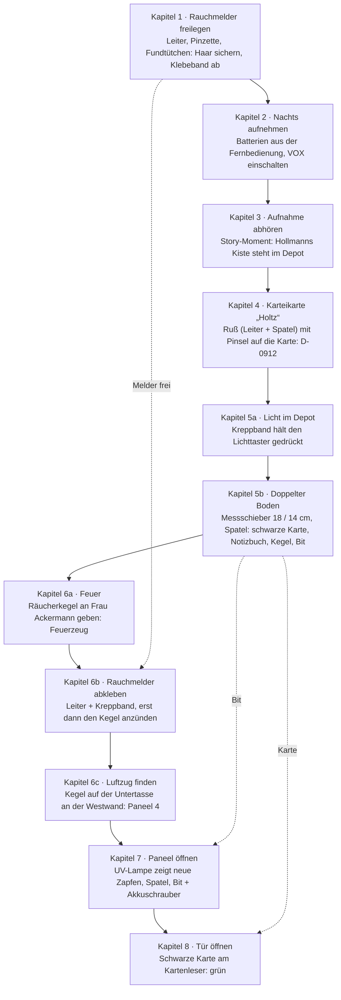

# Kyphi – Museum

## Spielfiguren

### Frau Ackermann (Rezeptionistin)

Frau Ackermann sitzt am Empfangstresen in der Lobby. Sie ist Anfang 60, streng, korrekt und heimlich herzlich. Ihr Lieblingssatz lautet: *„Ordnung muss sein.“*

- Sie trägt ihr **langes graues Haar** hochgesteckt. Das macht sie zur falschen Fährte für das Haar unter dem Klebeband.
- Sie raucht heimlich, gibt das aber nie zu, und spielt ständig nervös mit einem **Feuerzeug**.
- Sie verwaltet die Schlüssel und trägt jede Ausleihe gewissenhaft ein.

### Dr. Hollmann (Vorgänger)

Dr. Hollmann war Martins Vorgänger als Restaurator und ist vor zwei Jahren spurlos verschwunden. Offiziell gilt er als *vermisst*, nicht als *gekündigt*.

In Teil 1 tritt er nur indirekt auf: durch seine Werkzeugkiste, seine Notizen und die schwarze Karte, die er der Sekte abgenommen hat.

## Schauplätze

Teil 1 spielt an **fünf Schauplätzen**, jeder davon ist genau ein Bildschirm. Die Wohnung und das Museum sind direkt miteinander verbunden: Der Ausgang der Wohnung führt in die Lobby und umgekehrt. Der Altarraum gehört eigentlich zur Ausstellung, ist aber wegen der Restaurierung für Besucher gesperrt; im Spiel betritt Martin ihn nur über die Werkstatt.

| Schauplatz | Erreichbar über | Wichtigste Elemente |
| --- | --- | --- |
| Martins Wohnung | Lobby | Laptop, Diktiergerät, Fernbedienung |
| Lobby | Wohnung, Werkstatt, Keller | Frau Ackermann, Archivkartei, Schlüsselbrett |
| Altarraum | Werkstatt | Opferaltar, Rauchmelder, Holzverkleidung |
| Werkstatt | Lobby, Altarraum | Werkbank, Leiter, Kreppband, Akkuschrauber |
| Keller mit Depot | Lobby | Regale, Lagerkisten, Lichttaster |

### Martins Wohnung

Die Wohnung besteht aus **einem einzigen Raum**, einem Wohnzimmer mit Arbeitsecke. Küche, Bad und Schlafzimmer sind nicht begehbar. Die Wohnungstür führt direkt in die Lobby des Museums, durch deren großes Eingangsportal.

- **Schreibtisch** mit **Laptop** (zum Abhören der Aufnahme) und **Anrufbeantworter**
- **Diktiergerät** auf dem Schreibtisch, das Martin sonst für Restaurierungsnotizen nutzt; anfangs sind die Batterien leer
- **Sofa** mit **Fernbedienung**, in der zwei AA-Batterien stecken

### Lobby

Die Lobby ist der Knotenpunkt des Museums: hell, modern und wegen der Renovierung voller Abdeckplanen. Hier sitzt Frau Ackermann am Empfangstresen.

- **Archivkartei**: ein moderner Karteischrank, alphabetisch nach Nachlässen sortiert
- **Schlüsselbrett**: Der Depotschlüssel hängt hinter Frau Ackermann und ist nur über sie erreichbar
- **Dienstplan**: Er zeigt, dass Martin als Einziger im gesperrten Flügel arbeitet und die Reinigungsfirma nur montags kommt
- **Ausleihbuch**: Frau Ackermann trägt hier jeden ausgegebenen Schlüssel ein
- **Türen** (von links nach rechts):
  - Tür zum Treppenhaus, hinunter in den Keller mit dem Depot
  - Gläserne Doppeltür zum öffentlichen Museumsbereich; sie steht für Besucher offen, Martin darf aber nicht hindurch (keine Absperrung, Frau Ackermann hält ihn auf)
  - Tür zur Werkstatt, direkt neben der Glastür
  - Großes Eingangsportal ganz rechts, der Weg nach Hause in die Wohnung

Das Museum hat zwei Bereiche, die sich gegenseitig ausschließen:

- **Öffentlicher Bereich** (hinter der Glastür): für Besucher geöffnet, für Martin als Angestellten tabu.
- **Gesperrter Flügel** (Werkstatt, Altarraum, Keller mit Depot): für Besucher geschlossen, Martins Arbeitsbereich. Der Altarraum gehört sonst zur Ausstellung und ist nur wegen der Restaurierung gesperrt.

Klickt der Spieler auf die Glastür, hält Frau Ackermann Martin auf: *„Da drüben ist Publikumsverkehr, Herr Kessler. Sie mit Ihrem Staubkittel? Nein.“*

### Altarraum

Der Altarraum ist Martins aktuelles Restaurierungsprojekt und das Herz von Teil 1. Offenes Feuer ist hier streng verboten.

Eigentlich ist der Altarraum ein Ausstellungsraum des öffentlichen Bereichs. Während der Restaurierung ist er für Besucher gesperrt: Der Besucherzugang ist von der Ausstellungsseite her mit einer Bauwand verschlossen. Er liegt außerhalb des Bildausschnitts und spielt im Spiel keine Rolle. Deshalb kann nachts niemand unbemerkt durch den Besuchereingang kommen, und die Spur führt zur Westwand.

- **Altägyptischer Opferaltar** (6 × 3 m) und **Räucheraltar** (4 × 4 m) auf einem gemeinsamen Podest, das über zehn Stufen erreichbar und von großen Säulen umgeben ist; auf dem Räucheraltar liegt feine Asche, die süßlich nach Harz und Honig riecht
- **Ruß** an der Decke direkt über dem Altar
- **Rauchmelder** an der Decke, mit Klebeband abgedeckt
- **Altarschrank**: eine Nachbildung, in der Martin Material lagert; ein gutes Versteck für das Diktiergerät
- **Holzverkleidung an der Westwand**: Eichenpaneele, angeblich aus den 1920er-Jahren
- **Türen** (sichtbar und benutzbar):
  - Tür zur Werkstatt, links; von Anfang an benutzbar
  - Stahltür hinter Paneel 4 der Westwand, in den Untergrund; erst sichtbar, wenn das Paneel abgenommen ist (Kapitel 7), und erst mit der schwarzen Karte aus Hollmanns Kiste zu öffnen (Kapitel 8)
- Einen direkten Zugang zur Lobby gibt es nicht; der Besucherzugang ist verschlossen und nicht zu sehen

### Werkstatt

Die Werkstatt ist Martins Arbeitsraum und liefert die meisten Werkzeuge für die Rätsel.

- **Werkbank** mit Messschieber, UV-Lampe, Pinseln, Spatel, Pinzette und Fundtütchen
- **Malerleiter** in der Ecke
- **Kreppband**, beschriftet mit „VORSICHT – FRISCH RESTAURIERT“
- **Akkuschrauber**, ohne passenden Bit für Spezialschrauben
- **Untertasse**, auf der Martin sonst Retuschierfarben mischt
- **Türen**: Lobby, Altarraum

### Keller mit Depot

Im Depot lagert das Museum alles, was nicht ausgestellt ist.

- Lange Regalreihen mit **Lagerkisten**, jede mit einer Inventarnummer
- **Schlechte Beleuchtung**: Eine Neonröhre flackert, die Regalschilder sind kaum lesbar
- **Lichttaster**: Das Licht brennt nur, solange jemand den Taster gedrückt hält

## Handlung und Rätsel

Teil 1 erzählt in neun Kapiteln, wie Martin von einem verrußten Altar bis zur verborgenen Tür ins Tunnelsystem gelangt. Die Kapitel bauen aufeinander auf; innerhalb eines Kapitels kann der Spieler die Schritte teilweise frei wählen.

### Kapitel 0 – Prolog in Martins Wohnung

Es ist Morgen. Auf dem Anrufbeantworter ist eine Nachricht von Frau Ackermann:

> „Herr Kessler, Ackermann hier. Im Altarraum … da ist Dreck. Auf Ihrem Altar. Asche oder so was. Ich hab nichts angefasst. Kommen Sie bitte. Ordnung muss sein.“

Der Prolog dient als Tutorial. Der Spieler lernt die Steuerung, indem er den Laptop ansieht und das Diktiergerät nimmt. Das Diktiergerät hat leere Batterien; Ersatz steckt in der Fernbedienung.

> Martin: „Fernsehen wird ohnehin überschätzt.“

### Kapitel 1 – Der abgeklebte Rauchmelder

Im Altarraum liegt Asche auf dem Altar, und die Decke ist verrußt. Martin ist irritiert: Offenes Feuer ist hier streng verboten, und der Rauchmelder hätte längst anschlagen müssen.

**Rätsel 1 – An den Melder kommen**

1. Die Malerleiter aus der Werkstatt holen und am Melder benutzen.
2. Martin entdeckt, dass der Melder mit Klebeband abgedeckt ist. Darunter klebt ein **langes graues Haar**.
3. Mit der **Pinzette** nimmt er das Haar auf und steckt es in ein **Fundtütchen**. Mit bloßen Händen weigert er sich: *„Kontamination. Nein.“*
4. Aus Pflichtgefühl zieht er das Klebeband ab, denn es geht um Brandschutz.

Die Leiter bleibt nie stehen. Für jede Arbeit an der Decke klappt Martin sie kurz auf und danach wieder zusammen und nimmt sie mit, denn eine Leiter unter dem Melder würde den nächtlichen Besuchern auffallen. Beim ersten Mal sagt er es: *„Die nehme ich wieder mit. Eine Leiter unter dem Melder würde auffallen.“* Die Leiter bleibt deshalb im Inventar und wird für Melder und Ruß jedes Mal neu benutzt.

**Falsche Fährte:** Spricht man Frau Ackermann an, bemerkt Martin ihr graues, hochgestecktes Haar und wird misstrauisch. Fragt man sie direkt, empört sie sich: *„Ich bin um 17 Uhr zu Hause. Ich habe einen Kater, der wartet nicht.“* Wem das Haar wirklich gehört, bleibt bis Teil 2 offen.

**Erkenntnis:** Hier ist nachts jemand, und er bereitet sich vor. Martin will wissen, wer.

### Kapitel 2 – Belauschen

Martin beschließt, den Altarraum über Nacht abzuhören, und versteckt das Diktiergerät im **Altarschrank**.

**Rätsel 2 – Die ganze Nacht aufnehmen**

Untersucht man das Diktiergerät, zeigt es: *„Restkapazität: 4 Std.“* Das reicht nicht von 18 Uhr bis zum nächsten Morgen.

**Lösung:** Im Menü des Geräts die **Sprachaktivierung (VOX)** einschalten. Dann nimmt das Gerät nur auf, wenn es etwas hört.

> Martin: „Wenn da nachts niemand ist, habe ich morgen eine sehr leere Datei und ein sehr gutes Gewissen.“

Martin macht Feierabend und geht nach Hause. Ein Zwischenschnitt zeigt die Nacht, die Uhr steht auf 3:00. Am nächsten Morgen holt Martin das Gerät aus dem Schrank und hört die Aufnahme zu Hause am Laptop ab.

### Kapitel 3 – Die Aufnahme

Dieses Kapitel ist kein Rätsel, sondern ein Story-Moment. Die Aufnahme setzt um **3:02 Uhr** ein: Schritte, mehrere Personen, eine Tür. Es ist nicht die Tür zur Werkstatt, und der Besucherzugang ist mit der Bauwand verschlossen; das Geräusch ist dumpfer, wie Holz.

Dann folgt das Wichtigste:

> Stimme 1: „Der Melder ist frei.“  
> Stimme 2: „… Jemand war hier.“  
> Stimme 1: „Dann heute ohne Räucherwerk. Nur das Gebet. Und lasst ihn so. Wenn er morgen wieder zu ist, weiß er, dass wir es wissen.“

Danach ist ein leiser, gleichmäßiger Sprechgesang auf Altägyptisch zu hören, von dem Martin nur einzelne Wörter versteht. Am Ende entfernen sich Schritte. Kurz bevor die Tür zufällt, sagt eine ruhige, ältere Stimme:

> „… Hollmanns Kiste steht immer noch unten im Depot. Im Frühjahr ist Inventur. Holt sie raus, bevor der Neue sie findet.“

> Martin: „Der Neue. … Das bin ich.“

**Erkenntnis:** Die Sekte weiß, dass jemand am Melder war, und sie kennt Martin. Im Depot steht eine Kiste von Hollmann. Den Melder lässt die Sekte bewusst frei, um nicht aufzufallen; deshalb muss Martin ihn später selbst wieder abkleben.

### Kapitel 4 – Der Zugang zum Depot

Frau Ackermann gibt den Depotschlüssel nur gegen eine **Inventarnummer** heraus.

> „Ich muss das eintragen, Herr Kessler. Ordnung muss sein.“

**Rätsel 4 – Die verschwundene Karteikarte**

In der Archivkartei fehlt die Karte „Hollmann“. Zwischen „Hofmann, Sammlung“ und „Holtz, Grafik“ klafft eine Lücke; jemand hat sie entfernt. Martin kommentiert das knapp und ohne Begründung:

> Martin: „Hollmann fehlt. … Ich nehme die nächste Karte. Holtz.“

Die Karte „Holtz“ wandert ins Inventar. Beim Ansehen steht nur Belangloses darauf: *„Holtz, Gustav – Grafik / 2 Mappen Radierungen, 19. Jh. / B-0317“* (so lernt der Spieler nebenbei, wie eine Inventarnummer aussieht) Warum Martin sie mitnimmt, muss der Spieler selbst herausfinden: Wer auf einer Karteikarte schreibt, drückt die Schrift auf die nächste Karte im Stapel durch.

**Lösung** (Restauratorenwissen):

1. Mit der Leiter und dem **Spatel** etwas **Ruß** von der Decke über dem Altar abnehmen.
2. **Pinsel** und Ruß kombinieren.
3. Den Rußpinsel auf die Karte „Holtz“ anwenden. Die eingedrückte Schrift bleibt hell und wird lesbar:

> **Hollmann, Nachlass – Werkzeug, persönl. Gegenst. – D-0912**

Frau Ackermann trägt die Nummer ein und gibt den Schlüssel heraus.

> Ackermann: „Was haben Sie denn da an den Fingern?“  
> Martin: „Wissenschaft.“

### Kapitel 5 – Hollmanns Werkzeugkiste

**Rätsel 5a – Licht im Depot**

Das Kellerlicht hängt an einem Taster: Es brennt nur, solange jemand draufdrückt. Sobald Martin vom Taster weggeht, ist es dunkel. Die Regalschilder sind nur bei Licht lesbar, und auch an der Kiste lässt sich im Dunkeln nichts machen („Zu dunkel. Ich sehe nicht einmal, was in der Kiste liegt.“). Die Nummer **D-0912** bedeutet: Regal D, Fach 09, Platz 12.

**Lösung:** Den Taster mit dem **Kreppband** gedrückt festkleben, womit der Running Gag mit dem Klebeband beginnt. Die **UV-Lampe** ist als Taschenlampe zu schwach.

**Rätsel 5b – Der doppelte Boden**

In der Kiste liegt nur altes Werkzeug. Martin: *„Nichts. … Aber die Kiste ist zu schwer für das bisschen Werkzeug.“*

1. Mit dem **Messschieber** außen messen: 18 cm Tiefe.
2. Mit dem Tiefenmaß des Messschiebers innen messen: 14 cm.
3. Martin: *„Vier Zentimeter fehlen. Da ist ein doppelter Boden.“*
4. Den Boden mit dem **Spatel** an der Kante anheben.

Im Versteck liegen:

- **Schwarze Karte**: eine Chipkarte, ganz schwarz, ohne Namen und Foto, nur mit einer roten 666. Hollmann hat sie der Sekte abgenommen und dafür mit dem Leben bezahlt
- **Notizbuch** mit einer Skizze der Westwand: fünf Paneele, von hinten nach vorn nummeriert, eines davon schraffiert, aber welche Nummer, ist verwischt. Im Spiel heißen die Paneele entsprechend „Paneel 1“ bis „Paneel 5“
- **Räucherkegel** aus dunklem Harz
- ein **merkwürdiger Schrauberbit** mit Dreikantkopf, mit dem Martin noch nichts anfangen kann

Auf der letzten Seite des Notizbuchs steht in zittriger Schrift:

> „Sie kommen durch die Wand. Rauch lügt nicht.“

Den Depotschlüssel muss Martin Frau Ackermann zurückbringen, sonst lässt sie ihn nicht gehen: *„Ordnung muss sein.“*

### Kapitel 6 – Die Tür lokalisieren

Im Altarraum riecht Martin am Räucherkegel und an der Asche:

> „Honig, Wacholder, Harz … das ist Kyphi. Tempelräucherwerk. Dasselbe wie in der Asche.“

**Rätsel 6a – Feuer**

Martin hat kein Feuer. Das einzige Feuerzeug im Spiel gehört Frau Ackermann, und es taucht im Gespräch auf, damit der Spieler weiß, wo es zu finden ist:

> Martin: „Haben Sie Feuer?“  
> Ackermann: „Ich rauche nicht.“  
> Martin: „Und das Feuerzeug in Ihrer Hand?“  
> Ackermann: „Das ist für den Adventskranz.“  
> Martin: „Wir haben keinen Adventskranz.“  
> Ackermann: „Noch nicht. Ordnung muss sein.“

Fragt man erneut, bleibt sie hart: *„Für den Adventskranz, Herr Kessler.“*

**Lösung:** Martin gibt ihr den **Räucherkegel**. Sie riecht daran und wird weich:

> Ackermann: „Ein Räucherkegel … So einen hatte meine Mutter immer im Räuchermännchen. Weihnachten, die ganze Wohnung hat danach gerochen.“

Sie schiebt ihm Kegel und Feuerzeug über den Tresen:

> Ackermann: „Aber nicht hier in der Lobby. Und Sie haben das nicht von mir.“

Das **Feuerzeug** bleibt ab jetzt im Inventar.

**Rätsel 6b – Der Rauchmelder**

Zündet Martin den Kegel im Altarraum an, ohne den Melder abzukleben, löst der **Alarm** aus. Frau Ackermann stürmt herein, setzt den Alarm zurück und drückt den Kegel aus. Es gibt kein Game Over: Der Kegel lässt sich wieder anzünden, und das Feuerzeug nimmt sie nicht zurück, denn offiziell besitzt sie ja keins.

Das kann beliebig oft passieren. Ihre Reaktion wird nur jedes Mal knapper:

1. *„Herr Kessler! Offenes Feuer! Im Altarraum! Haben Sie den Verstand verloren?“*
2. *„Schon WIEDER? Ich habe einen Kater, Herr Kessler. Der wartet nicht.“*
3. *„Ordnung. Muss. Sein.“*
4. Ab dann kommt sie wortlos herein, drückt den Alarm weg, sieht ihn lange an und geht wieder.

**Lösung:** Mit der Leiter den Rauchmelder mit **Kreppband** abkleben und erst dann den Kegel anzünden.

> Martin: „Großartig. Jetzt bin ich einer von denen.“

**Rätsel 6c – Der Luftzug**

Martin stellt den rauchenden Kegel auf die **Untertasse** und trägt ihn an der Westwand entlang. An **Paneel 4** wird der Rauch in die Fuge gezogen; dahinter muss ein Hohlraum mit Luftzug liegen. Das passt zur verwischten Schraffur im Notizbuch.

### Kapitel 7 – Die Verkleidung öffnen

**Rätsel 7a – Welche Zapfen sind neu?**

Die Paneele sind mit Holzzapfen verschlossen, die die Schraubenköpfe verdecken. Mit bloßem Auge sehen alle gleich alt aus.

**Lösung:** Die **UV-Lampe** auf die Wand richten. Alter Schellack fluoresziert grünlich, frisches Holz und moderner Leim bleiben dunkel. Bei Paneel 4 leuchten **vier Zapfen nicht**: Sie sind neu, jemand hat sie wiederholt herausgenommen.

> Martin: „Die Zwanzigerjahre hatten keinen Weißleim.“

**Rätsel 7b – Die Schrauben**

Martin hebelt die Zapfen mit dem **Spatel** heraus. Darunter sitzen **Dreikant-Sicherheitsschrauben**, für die kein normaler Bit passt.

**Lösung:** Den Bit aus Hollmanns Kiste mit dem **Akkuschrauber** kombinieren und die Schrauben lösen.

> Martin: „Hollmann, du alter Fuchs. Du hast es gewusst.“

Das Paneel lässt sich abnehmen.

### Kapitel 8 – Die Tür mit dem Kartenschlitz

Hinter der Verkleidung verbirgt sich eine schlichte, neue **Stahltür** mit einem **Kartenleser**. Kein Logo, keine Nummer: Die hat nicht das Museum eingebaut.

Martin steckt die schwarze Karte ein. Eine kurze Pause, dann leuchtet die Anzeige **grün**. Die Karte gehört der Sekte; Hollmann hatte sie ihnen abgenommen.

> Martin: „Hollmann hat ihnen die Karte abgenommen. Und dafür bezahlt.“

Die Tür öffnet sich. Dahinter liegt eine enge Aufzugskabine, kühle Luft und der Geruch von Kyphi steigen herauf. Aus der Tiefe dringt ein **an- und abschwellendes Rauschen**, wie von einem Zug, der sehr schnell vorbeifährt.

**Ende von Teil 1.**

## Inventar

Alle Gegenstände von Teil 1 mit Fundort und Verwendung, in der Reihenfolge, in der der Spieler sie typischerweise findet.

| Gegenstand | Fundort | Verwendung |
| --- | --- | --- |
| Batterien | Fernbedienung (Wohnung) | Diktiergerät in Betrieb nehmen |
| Diktiergerät | Wohnung | Aufnahme im Altarraum (VOX-Modus) |
| Malerleiter | Werkstatt | Rauchmelder (zweimal), Ruß von der Decke |
| Pinzette und Fundtütchen | Werkstatt | Graues Haar sichern |
| Pinsel und Spatel | Werkstatt | Ruß auf Karteikarte, doppelter Boden, Holzzapfen |
| Karteikarte „Holtz“ | Archivkartei (Lobby) | Druckspuren sichtbar machen, ergibt D-0912 |
| Kreppband | Werkstatt | Lichttaster im Depot, Rauchmelder |
| Messschieber | Werkstatt | Kiste ausmessen |
| UV-Lampe | Werkstatt | neue Zapfen erkennen |
| Depotschlüssel | Frau Ackermann | Depot öffnen, danach zurückgeben |
| Schwarze Karte | Hollmanns Kiste | Stahltür öffnen |
| Notizbuch | Hollmanns Kiste | Hinweis auf die Westwand |
| Räucherkegel | Hollmanns Kiste | Frau Ackermann geben, danach Rauchprobe |
| Schrauberbit (Dreikant) | Hollmanns Kiste | Mit Akkuschrauber die Schrauben lösen |
| Feuerzeug | Frau Ackermann (gegen Räucherkegel) | Räucherkegel anzünden |
| Untertasse | Werkstatt | Rauchenden Kegel an der Wand entlangtragen |
| Akkuschrauber | Werkstatt | Mit Bit die Schrauben lösen |

## Rätsel-Abhängigkeiten

Hollmanns Kiste ist der Wendepunkt: Sie liefert Kegel, Bit und die schwarze Karte.

Teil 1 läuft weitgehend linear ab. Zwei Verbindungen reichen weit nach vorn: Das in Kapitel 1 entfernte Klebeband macht Kapitel 6b nötig, und Hollmanns Kiste liefert die Gegenstände für die Kapitel 6 bis 8.

## Offene Fäden für Teil 2

Teil 1 legt bewusst einige Spuren, die erst später aufgelöst werden:

- **Das graue Haar:** Wem gehört es? Frau Ackermann ist die naheliegende, aber falsche Fährte.
- **Die ältere Stimme:** Wer spricht auf der Aufnahme von Hollmanns Kiste und vom „Neuen“?
- **Dr. Hollmann:** Was hat er über die Sekte herausgefunden, und was ist aus ihm geworden?
- **Die Sekte weiß Bescheid:** Sie hat den freien Rauchmelder bemerkt und kennt Martin. Wie reagiert sie darauf?
- **Das Tunnelsystem:** Wohin führt die Treppe, und welche Orte verbindet der Zug?

## Nachtrag: Lift, Museum Bahn und Zug (gebaut)

Inzwischen geht es im Spiel hinter der Stahltür weiter:

- **Lift:** Ein Video zeigt die Fahrt mit dem Aufzug in 2 km Tiefe. Teller und Räucherkegel sollten dabei aus
  dem Inventar verschwinden (offen).
- **Museum Bahn** (`museum_station`): Bahnhof unter dem Museum mit ägyptischen Reliefs (höchstens zwanzig Jahre
  alt), Aufzug zurück in den Altarraum, verschlossenes Panzertor, der Zug in einer Schleuse mit offener Tür.
- **Zug** (`train_cabin`): Kabine mit Streckenkarte und fünf Zielen (Museum, ABC GmbH, Area 52, Innenerde,
  Antarktis). Anfahren lassen sich nur Ziele mit gebautem Bahnhof, derzeit Museum und Antarktis.
- Das Museum bleibt jederzeit über die Bahn erreichbar.
