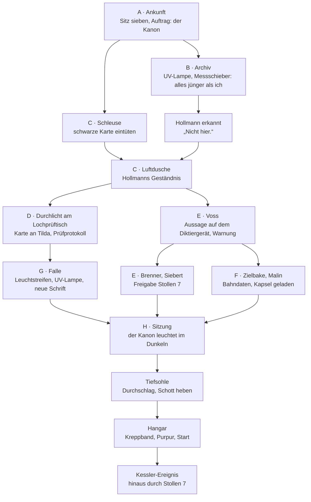

# Kyphi – Teil 3: Unter der Insel

> **Konzept fertig, noch nicht gebaut.** Schließt an `concept/area_52.md` an.

## Hintergrund

Hinter dem Hangartor liegt die eigentliche Anlage der Sekte, zwanzig Jahre alt und auf dem Stand von übermorgen.
Hier werden die Spiegel der Herde gebaut und gestartet, hier tagt das Kollegium, hier steht der Leitkern, der alle
50.000 Satelliten zugleich führen kann.

- **Betrieb** (Reinraum): Hangar mit der Startröhre, Spiegelhalle. Zutritt nur durch die Schleuse.
- **Kern:** Tageslichthalle, Ratssaal, Archiv, Atelier, Arrest. Ein gläserner Lift führt von der Hangargalerie
  hinunter.
- **Tiefsohle:** Pumpen, Kabel, Notwege. Der einzige dunkle Ort unter der Insel.
- **Leitkern:** nur für den Ältesten.

Unten ist immer Tag. Lichtsammler auf der Insel leiten Sonnenlicht durch Glasfasern in die Decke der
Tageslichthalle, nachts übernehmen LEDs. Die Anlage hält es auf zehn Uhr vormittags, seit zwanzig Jahren.

Running Gag: die Sonnenuhr in der Tageslichthalle. Martin: „Sie geht richtig. Seit zwanzig Jahren. Es ist zehn.“

### Aussehen

Der Spieler soll beim ersten Schritt sehen, dass hier dieselben Leute gebaut haben wie die Bahn.

- **Drei Farben:** mattes Weiß, schwarzes Glas, Purpur. Purpur ist die einzige Farbe und immer Licht: Leitlinien im
  Boden, Kartenleser, der Rand der sieben Sitze.
- **Keine Fugen, keine Schrauben, keine Schalter.** Flächen leuchten, Türen gleiten, Anzeigen liegen im Glas. Was
  Martin anfassen kann, fällt deshalb sofort auf: ein Endschalter, ein Schott, ein Schrank in der Tiefsohle.
- **Technik zum Staunen, aber denkbar:** die Startröhre (eine Vakuumröhre mit Linearmotor wie die Bahn, nur am
  Ende offen), ein halb entfalteter Spiegel von vierzig Metern, dünn wie Rettungsfolie, Faltroboter, die
  Tageslichtdecke, die Lagewand mit 50.000 Punkten.
- **Der Kontrast:** Mitten in dieser Welt liegen in Vitrinen aus Argon die „dreitausend Jahre alten“ Stücke der
  Sekte. Sie sind das Einzige, was hier alt aussieht.
- **Die Tiefsohle** ist das Gegenbild: roher Fels, Rohre, kaputte Lampen, grün nachleuchtende Streifen am Boden.

## Story in Kürze: „Ruß lügt nicht“

Martin kommt als der Mann herunter, der die Revisorin überführt hat. Unten erwartet ihn kein Verhör, sondern ein
Stuhl.

**Wendung 1:** Ein freier Sitz im Kollegium geht an den, der einen großen Fall löst. Das ist Martin. Er ist
Sitz sieben, und beschlossen ist bei der Sekte nur, worauf sieben Hände liegen. Seit einem halben Jahr wartet
„der lange Tag“ auf die siebte Hand. Martin: „Ohne mich kein Weltuntergang. Ich hätte zu Hause bleiben sollen.“

**Wendung 2:** Der Älteste, die Stimme vom Band, weiß seit Martins erster Fahrt, wer er ist. Er braucht zweierlei
von ihm: die Hand für die Abstimmung und die Hände eines Restaurators. Der Kanon, das heilige Purpurtuch der
Sekte, verblasst, und in ihm erscheint Schrift. Das Kollegium hält sie für eine Offenbarung und will sie
verlesen. Der Älteste will, dass dort steht, was er vorgibt, und dass darunter nie wieder etwas zu lesen ist.

**Wendung 3:** Im Atelier sitzt ein alter Mann mit langem grauem Haar und zitternden Händen: Hollmann lebt. Er
hat alles gemacht, was an dieser Sekte alt ist. Den Kanon, die Reliefs, den Schrein, die Steintafel im Saal des
Lichts. Die Sekte ist zwanzig Jahre alt. Ein Raumfahrtunternehmer hat sie erfunden, weil niemand für eine
Tabelle stirbt, für dreitausend Jahre aber schon. In jedes Stück hat Hollmann einen Fehler gebaut, in den Kanon
sein Geständnis, mit Rußtusche unter dem Purpur.

**Wendung 4:** Stollen 7 hat Hollmann bestellt, mit einem gefälschten Siegel bei seinem alten Kameraden Brenner:
ein Ausgang, der auf keinem Plan steht. Der Älteste ließ ihn von Voss sprengen. Voss sagt gegen ihn aus, und
Martin, der mit ihrer Karte ihren Rang hat, hebt als Revision ihre eigene Sperre auf.

**Wendung 5:** Die Sekte will die Nacht abschaffen, und die Wahrheit zeigt sich nur im Dunkeln. In der Sitzung
wird es für das Abendgebet einmal dunkel, und der Kanon beginnt zu leuchten. Der Älteste leugnet nichts. Er sagt
die Wahrheit, verliert die Abstimmung und geht: Für die Scheiben brauchte er sieben Hände, für das Licht nur
den Leitkern.

**Schluss:** „Das Licht folgt der Bake.“ Martin schießt die Zielbake mit der Startröhre mitten in die Herde. Die
50.000 Spiegel richten sich auf sie und verbrennen einander. Im Leitstand springt die Tafel auf 0: das erste
Kessler-Ereignis. Hinaus geht es durch Stollen 7.

## Was die Sekte wirklich ist

| Wann | Was |
|---|---|
| vor 21 Jahren | Albrecht Sander, Raumfahrtunternehmer, stürzt mit seinem Flugzeug über dem Atlantik ab und wird für tot erklärt. Seine Firma baut weiter „Internet-Satelliten“. Über Stiftungen kauft er die Insel. |
| vor 20 Jahren | Hollmann, Restaurator am Museum und verschuldet, fertigt für einen „Sammler“ ein Purpurtuch, Reliefs, einen Schrein und eine Steintafel. Er merkt bald, wofür. In jedes Stück baut er einen Fehler ein, den nur findet, wer nachmisst. |
| seitdem | Die „Hüter des Abendrauchs“ wachsen. Geweiht wird nachts am einzigen echten Stück, dem Opferaltar im Museum, das ihn nicht verkaufen wollte. Die ABC GmbH setzt die Tür in die Westwand. Hollmann singt vor. |
| vor 26 Monaten | Hollmanns Hände beginnen zu zittern. Ein Fälscher, der zittert, ist nur noch ein Zeuge. Er stiehlt der Novizin 666 die Karte, versteckt sie mit Notizbuch und Bit in seiner Kiste und bestellt bei Brenner mit gefälschtem Siegel Stollen 7. Am Tag darauf holt Kastner ihn nach unten. Seitdem ist er „der Archivar“. |
| vor einem halben Jahr | Sitz sieben wird frei. Ohne sieben Hände kein langer Tag. |
| seit Monaten | Unter dem Dauerlicht der Vitrine verblasst der Kanon. Schatten erscheinen. Der Älteste lässt die Röhre aus Hollmanns Leuchttisch nehmen. |
| vor zwei Monaten | Voss stößt in den Büchern der ABC GmbH auf einen Auftrag, den das Kollegium nie erteilt hat. Der Älteste: „Dieser Stollen kommt nie an. Wie, ist Ihre Sache. Danach reden wir über Sitz sieben.“ |
| vor drei Wochen | Martin beginnt am Altar. Hollmann lässt nachts Asche liegen und klebt ein Haar unter das Band am Rauchmelder. Er will wissen, ob der Neue hinsieht. |
| danach | Martin findet die Kiste, die Karte 666 fährt wieder. Der Älteste lässt ihn gewähren, Voss braucht einen Täter. Die Anhörung ist für den Ältesten die Prüfung: Wer Voss übersteht, ist gut genug. |

### Was die Grade glauben

| Grad | Was man ihm sagt |
|---|---|
| Grau | Wir hüten ein altes Feuer. Kyphi ist der Rauch des Abends: Er bringt die Sonne durch die Nacht. |
| Schwarz | Eines Tages endet die Nacht. Wir bereiten den langen Tag vor: Licht für die Polarnacht, Ernten im Winter. Malin rechnet dafür Bahnen. |
| Purpur | Der lange Tag ist eine Auslese. Die Erde wird gebremst, bis ein Tag ein Jahr dauert. Wer dann lebt, entscheidet das Licht. |
| Kollegium | Der Kanon befiehlt es, seit dreitausend Jahren. Wir führen nur aus. |
| Der Älteste | Ich habe es mir ausgedacht. |

### Der lange Tag

Der Plan liegt als Sitzungsmappe auf jedem der sieben Plätze (Vollbild):

> **Stufe 1 – Versiegeln.** Alle Zugänge von oben werden verglast: Museum, Werk, Station, Insel. Volle Herde.  
> **Stufe 2 – Bremsen.** Scheiben auf Volllast. Nach 30 Tagen dauert ein Tag 30 Stunden, nach 400 ein Jahr.  
> **Stufe 3 – Verteilen.** Auf der Nachtseite gibt es Licht nur, wo eine Bake steht. Wo Baken stehen, beschließt
> das Kollegium.  
> **Bestand nach zehn Jahren:** 0,1 %.

> Martin: „Auslöschen. Sie meinen das wörtlich. Sie machen das Licht aus.“

Auf jedem Zugang steht seit Jahren eine Bake. Die auf dem Dach des Museums hält Frau Ackermann für einen Kasten
der Telekom.

## Figuren

**Der Älteste, Albrecht Sander** (Sprecher `elder`, die ältere Stimme vom Band). Um die siebzig, kurzes weißes
Haar, freundlich wie ein Großvater, nie laut. Lebt als Einziger ständig unten. Er verachtet niemanden und
braucht niemanden, und beides merkt man erst spät. Seine Regeln hat er erfunden, damit sie alt aussehen, und muss
sich jetzt selbst daran halten, weil die anderen daran glauben.

> Ältester: „Sie haben meinen Rauchmelder freigelegt. Brandschutz, nehme ich an.“  
> Martin: „Pflichtgefühl.“  
> Ältester: „Eben. Ich brauche zwei Dinge von Ihnen, Herr Kessler. Ihre Hand und Ihre Hände.“

> Martin: „Und wenn ich einfach gehe und alles erzähle?“  
> Ältester: „Der Zug fährt. Gehen Sie zur Polizei. Der Polizeipräsident sitzt auf Platz vier.“

Sein Druckmittel: Ein Wort von ihm, und 666 ist ein Einbrecher mit gestohlener Karte. Und: „Frau Ackermann geht
um siebzehn Uhr. Sie hat einen Kater, der wartet nicht. Ich weiß gern, wann Menschen wo sind.“

**Dr. Eberhard Hollmann, „der Archivar“.** Martins Vorgänger. Anfang siebzig, langes graues Haar („Sechsundzwanzig
Monate ohne Friseur“), die Hände zittern. Trocken wie Martin, nur bitterer. Stolz auf jedes Stück und auf jeden
Fehler darin. Hat nie eine eigene Karte besessen: „Lieferanten bekommen keine.“ Kastner weicht ihm nicht von der
Seite.

> Hollmann: „Restaurieren und Fälschen ist dasselbe Handwerk. Der Unterschied ist die Rechnung.“

**Kastner, Zeremoniar** (purpur; Sprecher `cult1`, Stimme 1 vom Band). Um die vierzig, leise, kontrolliert. Führt
die Weihen im Museum, bewacht den Archivar, schließt die Türen. Glaubt alles.

**Tilda, Novizin 666** (grau; Sprecherin `cult2`, Stimme 2 vom Band: „… Jemand war hier.“). Um die dreißig,
Reinraumtechnikerin, sieht jedes Staubkorn. Ihr fehlt seit 26 Monaten die Karte. Gemeldet hat sie es nie: Wer
seine Karte verliert, verliert seinen Grad. Seitdem geht sie durch jede Tür als Zweite und fährt nur mit, wenn
ein anderer die Bahn ruft. Poliert seit drei Jahren denselben Ersatzspiegel, Nummer 50.001.

> Tilda: „Die Nummer wollte keiner. Ich war am Tag der Ausgabe krank.“

**Dr. Rautenberg, Sitz zwei.** Bahnmechanikerin, Herrin der Herde, Malins Vorgesetzte. Glaubt an den Kanon, weil
sie nie Anlass hatte, ihn zu prüfen. Sie ist die Erste, die die Hand wegnimmt.

**Wieland, Sitz vier.** Polizeipräsident. Behandelt das Kollegium wie einen Aufsichtsrat. Nach der Wahrheit: „Ich
habe nie etwas unterschrieben.“

**Sitz drei, fünf und sechs** (eine Reederin, ein General a. D., ein Bankier). Kaum Text. Sie reisen zur Sitzung
an und bleiben auch ohne Kanon bei der Sache.

**Dr. Voss** im Arrest. Aufrecht, als wäre die Zelle ihr Büro. Die rechte Hand ist purpurn und bleibt es.

**Von oben und von anderen Orten:** Malin, Feddersen, Brenner, Kowalke, Siebert, Pjotr, Frau Ackermann.

## Die Ordnung der Sieben

Sie steht im Ratssaal im Glas der Wand. Die Saalordnung von oben gilt weiter.

1. Erst der Abend, dann der Morgen. Im Dunkeln wird gebetet, im Licht gesprochen und gestimmt.
2. Beschlossen ist, worauf sieben Hände liegen.
3. Ein freier Sitz geht an den, der einen großen Fall löst.
4. Was im Kanon steht, wird verlesen.

> Martin: „Regel eins ist interessant. Hier unten wird es also doch einmal dunkel.“

## Was Martin mitbringt

| Gegenstand | Woher | Wofür |
|---|---|---|
| Purpurne Karte | Area 52, Anhörung | Hangartor, alle Türen; Rang der Revision; Startpult |
| Schwarze Karte (grauer Chip, 666) | Innenerde | staubt in der Schleuse; gehört Tilda |
| Zielbake | Area 52, Lichtöffnung des Saals | Startkapsel |
| Messschieber, UV-Lampe | Teil 1 | Stücke im Archiv prüfen; Leuchtstreifen laden |
| Spatel, Pinsel, Pinzette, Fundtütchen | Teil 1 | Leuchtstreifen, neue Schrift, Karte eintüten |
| Fundtütchen mit grauem Haar, Notizbuch | Teil 1 | Hollmann |
| Kreppband | Teil 1 | Endschalter der Startkapsel |
| Diktiergerät | Teil 1 | Aussage von Voss |

Teil 3 beginnt mit der purpurnen Karte am Hangartor. Alle anderen Orte bleiben erreichbar und werden gebraucht:
die Insel (Malin, Feddersen) und die ABC GmbH (Brenner, Siebert).

## Räume: was dort ist und was dort geschieht

### 1. Hangargalerie (scrollend)

Hinter der Personentür des Hangartors läuft eine gläserne Galerie über den Hangar. Unten, hinter Glas, liegt der
Reinraum: der Verschluss der Startröhre, ein Spiegel auf seinem Gestell, Roboter.

| Objekt | Aktion |
|---|---|
| Glasfront | Ansehen: der Hangar. „Eine Röhre wie die der Bahn. Nur dass sie am Ende offen ist.“ |
| Anzeige „Letzter Start vor 1.204 Tagen“ | Ansehen. Dieselbe Zahl wie auf Malins Tafel: Seitdem ist die Herde vollständig. |
| Durchsage bei der Ankunft | „Sitz sieben ist im Haus.“ Martin: „Sitz was?“ |
| Tür „Schleuse“ | Schleuse |
| Gläserner Lift | Tageslichthalle. Nach dem Schließen der Schotten außer Betrieb. |
| Personentür | Klippenweg |

### 2. Schleuse

Ein weißer Vorraum mit Spinden und die Luftdusche, eine Glaskabine mit Düsen.

| Objekt | Aktion |
|---|---|
| Overallspender | Reinraumoverall anziehen (über den Staubkittel). |
| Klebematte am Boden | Ansehen: siehe Rätsel 1. |
| Luftdusche, Schild „Max. 2 Personen“ | Benutzen: zwanzig Sekunden Sturm. „Ich verstehe mein eigenes Wort nicht.“ |
| Partikelzähler über der Innentür | Zeigt nach der Dusche den Wert. Die Tür öffnet unter 100. |
| Anzeige „Erkannte Karten“ | Ansehen: „Purpur – Revision. Grau – 666.“ |
| Innentür | Spiegelhalle |

### 3. Spiegelhalle (Reinraum, scrollend)

Hier werden die Spiegel gefaltet und geprüft. Alles ist weiß, Tilda auch.

| Objekt | Aktion |
|---|---|
| Tilda | Reden, Gegenstände geben. |
| Lochprüftisch | Ein Leuchttisch von sechs Metern. Die Spiegelfolie wird darübergezogen: Jedes Loch ist ein heller Punkt. Kanon benutzen: siehe Rätsel 4. |
| Ersatzspiegel 50.001 | Ansehen: „Dünner als Rettungsfolie und vierzig Meter breit.“ |
| Faltroboter | Kulisse. |
| Tor | Hangar |

### 4. Hangar (Startplatz)

Der Boden des Hangars, den Martin von der Galerie gesehen hat.

| Objekt | Aktion |
|---|---|
| Startröhre, Verschluss | Ansehen. Tilda: „Im Rohr ist alles abgeschirmt. Stahl und dreißig Meter Fels.“ |
| Startkapsel auf der Ladeschiene | Öffnen. Zielbake hineinstellen. Endschalter des Deckels: siehe Finale. |
| Startpult mit Kartenleser | Ohne Purpur: gesperrt. Bahndaten einlegen. Im Finale: starten. |
| Leiter im Startschacht | Hinunter in die Tiefsohle, auf die Rückseite von Schott T2. Vorher eine Sackgasse. |

### 5. Tageslichthalle (scrollend)

Der Knoten des Kerns: eine runde Halle unter einer Decke, die ein Vormittagshimmel ist. In der Mitte ein
Feigenbaum und eine Sonnenuhr.

| Objekt | Aktion |
|---|---|
| Decke | Ansehen: „Ein Himmel. Mit Wolken. Sie ziehen nicht.“ |
| Sonnenuhr | Ansehen: zehn Uhr. Hier spricht der Älteste zum ersten Mal mit Martin. |
| Der Älteste | Reden: der Sitz, der Kanon, die Vorlage. Später in der Sitzung. |
| Hinweistafel „Fluchtweg“ | Ansehen: „Langnachleuchtend. Steht da. Hier unten hat sie noch nie jemand leuchten sehen.“ |
| Türen | Ratssaal, Archiv, Atelier, Arrest, Treppe zur Tiefsohle, Lift zur Hangargalerie |
| Lift ohne Kartenleser, mit Handfläche | Leitkern. „Kein Schlitz. Der will keine Karte. Der will ihn.“ |

### 6. Ratssaal

Ein Ring aus schwarzem Glas mit sieben Sitzen. In der Mitte, unter einem Lichtkegel, die Vitrine des Kanons.
Genau darüber liegt der Saal des Lichts; das Sprechgitter führt hinauf.

| Objekt | Aktion |
|---|---|
| Sieben Sitze | Ansehen: Sechs tragen ein Zeichen, der siebte ist leer. Sitz sieben benutzen: Die Sitzung beginnt, wenn alles vorbereitet ist (siehe „Die Sitzung“). |
| Sitzungsmappe auf Sitz sieben | Nehmen. Vollbild: Tagesordnung und „Der lange Tag“. |
| Vitrine mit dem Kanon | Vollbild (Auflicht): siehe Rätsel 2. |
| Lagewand | Die Erde und 50.000 Punkte, größer als oben im Leitstand. |
| Ordnung der Sieben | Ansehen. |
| Räucherschale | Ansehen: Kyphi. „Honig, Wacholder, Harz. Hier unten also auch.“ |
| Dr. Rautenberg | Reden: die neue Schrift, der Abend, zwei Baken (siehe Rätsel 7). Dimmt auf Wunsch den Saal zur „Probe des Abends“. |

Die Tagesordnung:

> 1. Der Abend. 2. Der Morgen. 3. Verlesung der neuen Schrift. 4. Die sieben Hände.

### 7. Archiv

Ein Schaudepot aus Glas. Jedes Stück steht in Argon, jede Vitrine hat ein Schild mit Alter und Fundort.

| Objekt | Aktion |
|---|---|
| Schrein des Abendrauchs („Zedernholz, um 1250 v. Chr.“) | Ansehen, UV-Lampe benutzen: siehe Rätsel 2. |
| Relief „Die Barke hält an“ („Gründungsrelief“) | Ansehen, Messschieber benutzen: siehe Rätsel 2. |
| Abguss der Saalordnung | Ansehen: „Die Tafel aus dem Saal. Dieselbe Hand wie das Relief.“ |
| Leere Vitrine „Opferaltar – Leihgabe erbeten, abgelehnt“ | Ansehen: „Mein Altar. Den haben sie nicht bekommen.“ |
| Regalroboter | Kulisse. |

### 8. Atelier

Die beste Restaurierungswerkstatt, die Martin je gesehen hat, und eine Pritsche in der Ecke.

| Objekt | Aktion |
|---|---|
| Hollmann | Reden, Gegenstände zeigen. Kastner steht daneben. |
| Kastner | Reden: knapp. Bringt den Kanon im Klimakoffer und holt ihn wieder ab. |
| Stereomikroskop | Ansehen: „So eines beantrage ich seit drei Jahren.“ |
| Leuchttisch | Benutzen: bleibt dunkel. „Keine Röhre. Die Fassung ist sauber. Jemand hat sie herausgenommen.“ |
| Gläser, mit zittriger Schrift etikettiert | Ansehen: Krapp, Indigo, Gummi arabicum, Lampenruß. Muschelgold nehmen. |
| Arbeitstisch | Hier doubliert und retuschiert Martin den Kanon (Rätsel 6). |
| Partikelzähler an der Decke | Ansehen: „Der hat ein Loch zu viel. Das kenne ich.“ |

### 9. Arrest

Drei Zellen aus Glas, eine belegt.

| Objekt | Aktion |
|---|---|
| Dr. Voss | Reden. Diktiergerät benutzen: siehe Rätsel 5. |
| Sprechanlage | Ansehen. Voss: „Tot. Der Arrest gehört der Revision. Es ist der einzige Raum hier unten, in dem niemand mithört. Ich habe ihn selbst eingerichtet.“ |

### 10. Tiefsohle (scrollend)

Roher Fels unter dem Kern. Die Lampen sind seit Jahren kaputt, hier unten sitzt kein Sitz.

| Objekt | Aktion |
|---|---|
| Tür zur Treppe | Fällt sie zu, ist es dunkel bis auf die Streifen am Boden. Martin: „Grün. Die Streifen haben das Licht aus dem Treppenhaus behalten.“ |
| Leitstreifen am Boden | Ansehen. Spatel benutzen: „Festgeklebt und voller Dreck. Die reißen.“ |
| Schrank „Leitmarkierung“ | Rolle Leuchtstreifen nehmen. „Die lag im Dunkeln. Die leuchtet nicht.“ |
| Pumpensumpf | Ansehen: Wasser, Fels. Später: Klopfen von unten. Im Finale der Durchschlag von Stollen 7. |
| Schott T2 | Zu. Schild „Reinraumgrenze“. Kein Kartenleser, kein Griff: „Das öffnet nur die Leitstelle.“ Im Finale: siehe Finale. |
| Leiter hinter dem Schott | Startschacht, hinauf in den Hangar |

### 11. Leitkern

Ein Raum, eine Wand, 50.000 Punkte, ein Stuhl. Martin sieht ihn nur am Schluss, durch die Glastür.

## Rätsel

### 1. Der Dreck bin ich

Die Innentür der Schleuse öffnet erst unter 100 Partikeln.

1. Im Staubkittel: „4.812. Zutritt verweigert.“ Martin: „Drei Wochen Altarstaub, Ruß und Bentonit. Endlich ein
   Ort, an dem man mich versteht, und ausgerechnet hier bin ich der Dreck.“
2. **Reinraumoverall** anziehen: „612.“ Martin: „Besser. Aber irgendetwas an mir staubt noch.“
3. **Klebematte** ansehen: „Schwarze Krümel, genau dort, wo ich gestanden habe. Sie glänzen kupfrig.“
4. **Schwarze Karte** ansehen: „Kohlebürstenstaub in Walnussöl. An den Kanten reibt sie ab.“
5. **Lösung:** die schwarze Karte in ein **Fundtütchen** stecken. „38. Zutritt.“

Der Spieler kennt die Farbe aus der Innenerde und das Tütchen aus Teil 1. Was nicht in den Reinraum darf, wird
dort wirklich eingetütet.

In die Spiegelhalle muss Martin erst für Rätsel 4. In den Kern kommt er ohne Schleuse mit dem Lift.

### 2. Alles jünger als ich

Im Ratssaal, Kanon im Auflicht (Vollbild): ein Leinentuch, purpur gefärbt, mit goldenen Hieroglyphen.

> Martin: „In der Mitte ist er schieferblau, am Rand unter dem Rahmen noch purpurn. Das ist ein Lichtschaden.
> Echter Purpur bleicht nicht. Der wird im Licht erst. Das weiß ich von einer Wäscheleine.“  
> Martin: „Und zwischen den Zeilen stehen Schatten. Im Auflicht komme ich da nicht weiter.“

Im Archiv:

> Martin: „Dreitausend Jahre und keine einzige Fehlstelle. Entweder haben die den besten Restaurator der Welt,
> oder …“

Den Rest findet der Spieler mit dem Werkzeug aus Teil 1:

- **UV-Lampe** auf den Schrein: „Der Überzug leuchtet grünlich. Die Dübel nicht. Weißleim. Schon wieder.“
- **Messschieber** an das Relief: „Die Figuren stehen in einem Raster. Jedes Feld 50,0 Millimeter. Auf den
  Zehntelmillimeter. Die Ägypter haben in Ellen, Handbreiten und Fingern gemessen. Den Meter gibt es seit 1799.“
- **Relief ansehen** (ohne Werkzeug): „Die Rillen sind alle gleich breit und gleich tief. Das kann kein
  Kupfermeißel. Ein Winkelschleifer schon.“

Nach zwei Befunden:

> Martin: „Alles hier unten ist jünger als ich.“

### 3. Der Archivar

Im Atelier stellt sich ein alter Mann als „der Archivar“ vor. Namen gebe es hier unten nicht. Zum Kanon sagt er
nur: „Ich restauriere nicht mehr. Die Hände.“

1. Martin beim Ansehen: „Langes graues Haar. Ich habe eines davon in einer Tüte.“
2. **Fundtütchen mit Haar** oder **Notizbuch** zeigen:

> Martin: „‚Sie kommen durch die Wand. Rauch lügt nicht.‘ Die Schrift zittert. Wie auf Ihren Gläsern.“  
> Hollmann: „Sie haben die Kiste gefunden. Mit dem Messschieber?“  
> Martin: „Vier Zentimeter.“  
> Hollmann: „Guter Mann.“ (Blick zur Decke.) „Nicht hier.“

3. Mit den Befunden aus dem Archiv dasselbe: „Dann haben Sie gemessen. Das hat seit zwanzig Jahren keiner. Nicht
   hier.“
4. **Das Problem:** Kastner steht daneben, der Zähler an der Decke hört mit. Martin: „Ich muss mit ihm reden, wo
   keiner zuhört.“ Als Sitz sieben darf er den Archivar überallhin mitnehmen, Kastner geht mit.
   - Tageslichthalle: Kastner bleibt zwei Schritte dahinter.
   - Arrest: Voss: „Hier hört niemand zu. Außer mir.“ Hollmann: „Vor der nicht.“
   - Kreppband auf den Zähler: „Dann steht Kastner nicht mehr daneben, sondern dazwischen.“
5. **Lösung:** die **Luftdusche**. Martin bestellt den Archivar „für den Befund“ in die Spiegelhalle. Die Kabine
   fasst zwei Personen, Kastner wartet vor dem Glas, und drinnen versteht zwanzig Sekunden lang niemand ein
   Wort, auch kein Mikrofon. Martin drückt den Knopf dreimal: „Noch einmal. Der Archivar staubt.“

Hollmann, gegen die Düsen angeschrien, in drei Stücken:

> „Alles hier ist von mir. Der Kanon, der Schrein, die Reliefs, die Tafel oben im Saal. Sander hat bestellt, ich
> habe geliefert. In jedes Stück habe ich einen Fehler gebaut. Zwanzig Jahre hat keiner nachgemessen.“

> „Der größte steckt im Kanon. Legen Sie ihn ins Durchlicht. Meinen Leuchttisch hat er leeren lassen. Er weiß,
> was darunter steht. Die anderen sechs nicht.“

> „Stollen 7 ist auch von mir. Ein Auftrag mit Siegel, an Brenner. Das Siegel habe ich selbst geschnitten. Er
> sollte unter dem Pumpensumpf ankommen. Ein Ausgang, der auf keinem Plan steht.“

Später, wenn der Spieler nachfragt (wieder in der Dusche):

- Das Haar: „Ich klebe seit vierzig Jahren. Glauben Sie, mir rutscht ein Haar unter das Band? Die Asche habe ich
  auch liegen lassen. Ich wollte wissen, ob der Neue hinsieht.“
- Die Karte: „Der Kleinen aus dem Reinraum abgenommen, bei einer Tasse Tee. Ich schulde ihr 26 Monate.“
- Das Gebet auf Altägyptisch: „Was die seit zwanzig Jahren beten, ist ein Rezept. Honig, Wein, Rosinen,
  Wacholder. Sechzehn Zutaten. Es steht in Edfu an der Wand des Laboratoriums.“

### 4. Durchlicht

Der Älteste hat Martin den Auftrag gegeben, Kastner bringt den Kanon im Klimakoffer ins Atelier. Bis zur Sitzung
verantwortet Sitz sieben das Tuch.

> Martin: „Ich bräuchte Durchlicht. Hollmanns Leuchttisch ist tot.“

1. Der Spieler hat in der Spiegelhalle den **Lochprüftisch** gesehen: sechs Meter Licht von unten.
2. Kanon mit dem Lochprüftisch benutzen. Tilda stellt sich davor:

> Tilda: „Ein dreitausend Jahre altes Tuch? Auf meinem Tisch? Wissen Sie, was das an Partikeln abgibt?“

3. Tilda auf die Anzeige der Schleuse ansprechen oder ihr die eingetütete Karte zeigen:

> Tilda: „Grau, 666. In einer Tüte. Schwarz angemalt.“  
> Martin: „Sie kennen die Karte?“  
> Tilda: „Ich suche sie seit 26 Monaten. Sie sind nicht 666. Ich bin 666.“  
> Martin: „Dann wissen wir jetzt beide etwas, das keiner wissen darf.“

4. **Lösung:** ihr die **schwarze Karte** geben. „Sie ist inzwischen befördert worden. Nur äußerlich. Der Chip ist
   grau, der Rest ist Walnussöl.“ Tilda räumt den Tisch.
5. Vollbild: der Kanon im Durchlicht. Von den goldenen Zeichen bleiben dünne Striche. Quer über das ganze Tuch
   steht schwarz, in lateinischen Buchstaben:

> „DIES IST KEIN KANON. Leinen von 2006. Krapp und Indigo nach dem Papyrus Holmiensis. Rußtusche. Gemacht für
> Albrecht Sander. Vor ihm gab es keine Sekte. – Dr. E. Hollmann, Restaurator. Ruß lügt nicht.“

> Tilda: „Dreitausend Jahre. Wie viele Partikel sind das?“  
> Martin: „Zwanzig.“  
> Tilda: „Partikel?“  
> Martin: „Jahre.“

6. Die Kamera des Tisches druckt ein **Prüfprotokoll** mit dem Bild.

Der Purpur verblasst, weil er keiner ist: Krapp bleicht im Licht, Ruß nie. Deshalb kommt die Schrift von selbst
hervor, und deshalb kann niemand sie entfernen.

### 5. Die Revision sagt aus

Im Arrest, nach Hollmanns Geständnis.

> Voss: „Ein Auftrag mit Siegel, den das Kollegium nie erteilt hat. Ich habe ihn dem Ältesten gemeldet. Er hat
> gesagt: Dieser Stollen kommt nie an. Wie, ist Ihre Sache.“  
> Martin: „Und 412?“  
> Voss: „Hat Zünder gezählt. Das war nicht bestellt. Das war ich.“

1. **Diktiergerät** benutzen. Voss stellt eine Bedingung:

> Voss: „Hier unten verschwindet man. Wenn Brenner durch ist, gehe ich mit hinaus. Vor ein Gericht, das nicht
> ihm gehört.“  
> Martin: „Ein Gericht. Damit kann ich leben.“

2. Sie spricht ihre Aussage auf: **Diktiergerät mit Aussage**.
3. Sie warnt, ungefragt und genau:

> Voss: „Sie wollen ihn vor den Sechs bloßstellen. Gut. Rechnen Sie nach. Für die Scheiben braucht er sieben
> Hände. Für das Licht braucht er niemanden. Ich würde vorher dafür sorgen, dass er es nicht mehr hat.“

Damit weiß der Spieler vor der Sitzung, dass die Wahrheit allein nicht reicht.

### 6. Die Falle im Kanon

Der Auftrag des Ältesten, an der Sonnenuhr:

> Ältester: „Im Kanon erscheint Schrift. Das Kollegium hält sie für eine Offenbarung und will sie verlesen. Sie
> sorgen dafür, dass dort steht, was ich Ihnen gebe. Und dass darunter nichts mehr zu lesen ist. Nie mehr.“

Er gibt Martin die **Vorlage**: eine Zeile Hieroglyphen, „Es werde Tag“. Hollmann dazu: „Das hat er aus meinem
Wörterbuch. Der zweite Vogel steht verkehrt herum.“

Das Problem benennt Martin nach dem Durchlicht:

> Martin: „Ruß geht nicht heraus. Kohlenstoff ist das Beständigste, was es gibt. Ich kann ihn nur zudecken.“  
> Martin: „Und zeigen kann ich ihn auch nicht. Im Ratssaal liegt der Kanon auf Stein, und alles, was ein Kabel
> hat, sieht der Älteste.“

Was der Spieler weiß: Regel eins (in der Sitzung wird es dunkel), die Fluchtwegtafel in der Tageslichthalle
(„langnachleuchtend“), die grünen Streifen in der Tiefsohle. Rautenberg zeigt auf Wunsch die „Probe des Abends“:
Der Saal wird dunkel, über der Tür glimmt das Fluchtwegschild. Martin: „Das Einzige hier unten, das die
Dunkelheit kennt.“

1. **Rolle Leuchtstreifen** aus dem Schrank in der Tiefsohle. Die Streifen am Boden taugen nicht.
2. Im Atelier: Leuchtstreifen mit dem Kanon benutzen. Martin klebt die Streifen dicht an dicht auf einen neuen
   Träger und legt das Tuch darauf. „Doublieren. So heißt das wirklich. Ein neues Gewebe unter das alte.“
3. **Laden:** Die Rolle lag im Dunkeln. **UV-Lampe** mit den Streifen benutzen: „Zu schwach als Taschenlampe,
   zu schwach für Purpur. Dafür reicht sie.“ Ohne Laden: „So leuchtet da heute Abend nichts.“
4. **Neue Schrift:** **Muschelgold** und **Pinsel**, dazu die Vorlage. Martin malt die Zeile des Ältesten über die
   Schatten. Ohne sie nimmt Kastner den Kanon nicht ab.
5. Kastner holt den Kanon. Er hält eine Lampe dahinter: Nichts scheint durch. Die Streifen sind dicht.

> Kastner: „Kein Schatten mehr.“  
> Martin: „Doubliert. Wie bestellt.“

Im Licht sieht niemand, dass die Unterlage leuchtet. Sie braucht kein Kabel und keinen Schalter. Die Falle spannt
das Licht des Ältesten, und sein eigenes Abendgebet löst sie aus.

### 7. Die Bahn mitten durch die Herde

Nach Voss' Warnung:

> Martin: „Fünfzigtausend Spiegel. Die bekomme ich nicht herunter. Nicht mit einem Spatel.“

1. **Rautenberg** oder **Malin** nach zwei Baken fragen:

> Malin: „Zwei Baken gleichzeitig? Dann nimmt jeder Spiegel die nähere. Jeder für sich. Deshalb gibt es bei uns
> nie zwei.“

2. **Hangargalerie:** die Startröhre. Tilda: „Starten darf nur Purpur. Ich lade nur.“
3. **Zielbake** von der Lichtöffnung des Saals holen (Klippenweg).
4. **Malin** die **Sitzungsmappe** zeigen. Sie liest Stufe 1 bis 3.

> Malin: „Licht für die Polarnacht. Ernten im Winter. Dafür rechne ich.“  
> Martin: „Sie rechnen Bahnen und fragen nicht, wofür. Fragen Sie einmal.“  
> Malin: „… Was brauchen Sie?“  
> Martin: „Eine Bahn. Mitten durch Ihre Herde.“  
> Malin: „Wissen Sie, was dann passiert? Dann ist der Himmel zu. Für hundert Jahre. Und auf meiner Tafel steht
> eine Null.“

   Sie rechnet: **Bahndaten**.
5. **Hangar:** Zielbake in die Startkapsel, Bahndaten ins Startpult. Tilda: „Im Rohr sieht die Herde sie nicht.
   Erst draußen.“

Martin muss kein Pult erobern. Den Befehl an die volle Herde gibt der Älteste selbst. Die Bake muss nur zur
rechten Zeit dort sein, wo sie jedem Spiegel näher ist als das Museum.

### 8. Die letzten vierzig Meter

1. Von Hollmann weiß Martin, wo Stollen 7 ankommen sollte, von Voss, wer ihn gesprengt haben wollte.
2. **ABC GmbH, Brenners Büro:** Brenner zeigt den Auftrag. „Mit Siegel. Ich habe nie gefragt, von welchem Sitz.“
   Bohren will er nicht: „Der Stollen ist gesperrt. Durch die Revision.“ Und er hält den Ältesten für den Mann,
   der ihn gerettet hat.
3. **Diktiergerät mit Aussage** bei Brenner abspielen.

> Brenner: „Mirko lag elf Tage unter dem Stempel.“ (Pause.) „Vierzig Meter. Zwei Schichten.“

4. **Siebert:** „Was die Revision gesperrt hat, hebt nur die Revision auf. Vorschrift ist Vorschrift.“ Martin legt
   die **purpurne Karte** auf den Tresen. Siebert, nach einem Blick in die Liste: „Die Revision sind dann wohl
   Sie.“ Er stempelt die **Freigabe Stollen 7**.
5. Freigabe an Kowalke. Der Vortrieb läuft. In der Tiefsohle ist am Pumpensumpf bald ein Klopfen zu hören.

Weil die Revision ungebucht fährt, steht Martins Fahrt zur ABC GmbH auf keiner Anzeige. Der Älteste, der gern
weiß, wann Menschen wo sind, weiß es diesmal nicht.

### Freiwillig: der Umschlag

Feddersen das **Prüfprotokoll** geben. „Ich schicke jeden Monat meine Zählung ans Institut. Seit vierzig Jahren.
Den Umschlag macht keiner auf, der ihn nicht aufmachen soll.“ Ändert nur den Epilog: Dann wissen draußen die
Richtigen Bescheid, bevor Wieland es verhindern kann.

## Die Sitzung

Sitz sieben benutzen. Martin setzt sich erst, wenn alles steht, und nennt sonst, was fehlt:

| Fehlt | Martin |
|---|---|
| Kanon nicht abgegeben | „Ohne Kanon keine Sitzung. Und ohne meine Unterlage keine Wahrheit.“ |
| Bake nicht in der Kapsel | „Voss hat recht. Wenn ich ihn bloßstelle, hat er immer noch das Licht.“ |
| Freigabe für Stollen 7 fehlt | „Es gibt genau eine Tür nach draußen, und die gehört ihm.“ |

Dann läuft die Sitzung als Sequenz mit wenigen Eingriffen des Spielers.

| Schritt | Was geschieht |
|---|---|
| 1 | Die Sechs sitzen, Martin nimmt Platz. Hollmann steht als Vorbeter am Kanon, Kastner an der Schale. |
| 2 | **Der Abend.** Die Decke wird rot, dann schwarz. Kastner entzündet das Kyphi. Hollmann singt. |
| 3 | Der Kanon beginnt grün zu leuchten. Von der goldenen Zeile bleibt ein dünner Strich. Groß und schwarz steht darin, was Hollmann vor zwanzig Jahren geschrieben hat. Im Dunkeln spricht niemand. Alle lesen. |
| 4 | Hollmann hört auf zu singen. „Honig. Wein. Rosinen. Wacholder. Das ist es, was ich Ihnen seit zwanzig Jahren vorsinge. Ein Rezept.“ |
| 5 | Ältester: „Licht.“ **Der Morgen.** Das Leuchten ist fort, im Kanon steht golden „Es werde Tag“. Ältester: „Der Archivar ist alt. Verlesen wird im Licht.“ |
| 6 | General: „Leuchtfarbe. Ein Trick des Novizen.“ Martin ist am Zug: Der Spieler legt einen Beweis vor, der im Licht gilt. |
| 7 | Rautenberg zum Ältesten: „Die Hand auf den Kanon. Ist das wahr?“ |
| 8 | Der Älteste legt die Hand auf und sagt die Wahrheit (siehe unten). Er ruft zur Abstimmung. |
| 9 | Drei Hände kommen, Rautenberg und Wieland bleiben sitzen. Alle sehen auf Sitz sieben. Der Spieler wählt. |

Schritt 6, Beweise im Licht: der **Messschieber** am Kanon („Zeilenabstand 20,0 Millimeter. Jede Zeile.“) oder
das **Prüfprotokoll** mit dem Durchlichtbild. Einer genügt. Bei einem falschen Gegenstand sagt Kastner: „Das
gehört nicht hierher.“

Schritt 8:

> Ältester: „Zwanzig Jahre. Hollmann hat es gemacht, ich habe es bestellt. Ich lüge nicht im Licht. Die Regel ist
> von mir.“  
> Ältester: „Niemand stirbt für eine Tabelle. Für dreitausend Jahre schon. Sie alle kennen die Tabelle. Sie
> stimmt noch. Der Kanon war nie der Grund. Er war die Verpackung.“

Schritt 9, zur Wahl:

- „Sie haben alle belogen.“ → Kastner: „Das ist eine Anklage, Sitz sieben. Regel vier.“ Ältester: „Lassen Sie
  ihn. Er hat ja recht.“ Es ändert nichts.
- Hand auflegen → Martin: „Nein.“
- **Hand wegziehen:**

> Martin: „Erste Regel in meinem Beruf: Jeder Eingriff muss sich rückgängig machen lassen. Ihrer lässt sich
> nicht.“

Vier Hände. Beschlossen ist nichts.

> Ältester: „Dann ohne Sie. Die Sieben waren auch von mir.“

Er geht mit Kastner zum Lift mit der Handfläche. An der Tür:

> Ältester: „Was wollen Sie jetzt tun, Herr Kessler? Es abkleben?“

## Finale

Aus den Lautsprechern: „Schotten zu.“ Der Lift zur Galerie fällt aus, das Hangartor verriegelt. Auf der Lagewand
läuft Stufe 1:

> „Versiegeln. Ziel 1: Museum. Volle Herde. Licht in 20 Minuten.“

Rautenberg: „Dafür braucht er uns nicht. Die Herde hört auf den Leitkern.“ Die Uhr läuft nur in der Erzählung,
nicht gegen den Spieler.

1. **Tiefsohle.** Der einzige Weg zum Hangar. Schott T2 ist zu wie immer.
2. **Der Durchschlag.** Am Pumpensumpf bricht die Wand. Kowalke steckt den Kopf durch das Loch: „Glück auf. Ist
   das hier Area 52?“ Hinter ihm Brenner.
3. **Schott T2 heben.** Kowalke hat einen Hebestempel und Kanthölzer dabei. Stempel benutzen: Das Schott hebt
   sich eine Handbreit. Zweimal hintereinander ohne Unterbauen: Kowalke bricht ab. Kantholz unterlegen, dreimal im
   Wechsel, wie in der Kammer von Stollen 7. Kowalke: „Einen Zoll heben, einen Zoll unterbauen. Sie haben
   aufgepasst.“
4. **Hangar.** Tilda: „Sie kommen aus dem Keller? Ungeduscht?“ Die Kapsel meldet „Deckel offen“: Die Bake ist drei
   Zentimeter zu hoch, der Deckel erreicht den Endschalter nicht.
5. **Kreppband** auf den Endschalter, wie an der Wetterschleuse der Innenerde. „VORSICHT – FRISCH RESTAURIERT.“
6. **Purpurne Karte** ins Startpult. Start.

Sequenz: Die Kapsel schießt aus der Steilwand über dem Meer. Die Seeschwalben fliegen auf. Feddersen sieht auf
die Uhr und schreibt.

Im Leitstand: Auf der Wandanzeige drehen sich 50.000 Punkte, erst zum Museum, dann, einer nach dem anderen, zu
einem einzigen Punkt in ihrer Mitte. Der Punkt glüht. Dann erlöschen die ersten ringsum, dann die dahinter, eine
Welle um die ganze Erde. Die Tafel springt um: „Tage ohne Kessler-Ereignis: 0“.

> Malin: „Tausendzweihundertvier.“

Über dem Museum wird es nicht hell. Frau Ackermann schließt um siebzehn Uhr ab.

**Am Leitkern.** Durch die Glastür: der Älteste vor einer Wand, auf der die Punkte ausgehen. Kastner legt seine
Karte auf den Boden und geht.

> Ältester: „Sie haben den Himmel zugemacht, Herr Kessler. Für hundert Jahre kommt dort keiner mehr durch.“  
> Martin: „Dafür wird es heute Abend dunkel.“  
> Ältester: „Bei mir nicht.“

Er bleibt. Die anderen gehen durch Stollen 7 hinaus: das Kollegium, Hollmann an Tildas Arm, Voss zwischen Brenner
und Kowalke.

> Voss: „Es war nicht persönlich, Brenner.“  
> Brenner: „Bei mir schon.“

## Epilog

Martin hat den Rang der Revision, und die Revision sperrt.

- **ABC GmbH:** Siebert legt Tilda die Rechnung vor: 26 Monate Beitrag. „Gestohlen? Dann brauche ich eine
  Verlustanzeige. Rückwirkend.“ Hollmann: „Schicken Sie sie mir.“
- **Innenerde:** Mit der purpurnen Karte öffnet Martin die Zeitkammer. Das Pendel, die Anzeige: „Tageslänge
  heute: 86.400,0021 Sekunden.“ Er schaltet die Scheiben ab und klebt Kreppband über den Hauptschalter.
  „Gesperrt durch die Revision.“
- **Antarktis:** Pjotr trennt die Antenne. „Klar schalte ich ab! Den Kaffeeautomaten auch?“ – „Den nicht.“
- **Unter der Insel:** Ohne Strom aus der Antarktis springen bei Sonnenuntergang keine LEDs mehr an. Zum ersten
  Mal seit zwanzig Jahren wird es in der Tageslichthalle Abend. Im leeren Ratssaal leuchtet der Kanon.
- **Insel:** Malin rechnet wieder. „Fünfzigtausend Trümmer. Jemand muss wissen, wo sie sind.“ Feddersen: „Seit
  drei Tagen keine Störung. Den Vögeln fehlt was.“

**Museum, Monate später, erster Advent.** Hollmann steht in der Lobby.

> Ackermann: „Dr. Hollmann. Sie haben seit 26 Monaten einen Werkstattschlüssel. Ordnung muss sein.“

Im Altarraum richtet Martin die UV-Lampe auf den Altar. „Der ist echt. Wenigstens einer.“ Er steigt auf die
Leiter und zieht sein Kreppband vom Rauchmelder. „Brandschutz.“

In der Lobby steht ein Adventskranz. Martin legt das Feuerzeug auf den Tresen.

> Ackermann: „Ich rauche nicht.“  
> Martin: „Für den Adventskranz.“  
> Ackermann: „Auf dem Dach steht übrigens ein Kasten, Herr Kessler. Der gehört da nicht hin.“  
> Martin: „Der kann weg.“

Draußen wird es dunkel. **Ende.**

## Ablauf mit allen Kombinationen

### A. Ankunft

1. Purpurne Karte + Hangartor → Hangargalerie → Lift → Tageslichthalle
2. Ältester an der Sonnenuhr: Sitz sieben, „Ihre Hand und Ihre Hände“
3. Ratssaal: Sitzungsmappe, Ordnung der Sieben, Kanon im Auflicht, Rautenberg

### B. Alles jünger als ich

4. Archiv: UV-Lampe + Schrein, Messschieber + Relief
5. Atelier: Fundtütchen mit Haar oder Notizbuch → Hollmann: „Nicht hier.“

### C. Schleuse und Luftdusche

6. Reinraumoverall, Fundtütchen + schwarze Karte → Zutritt zur Spiegelhalle
7. Hollmann in die Spiegelhalle bestellen, Luftdusche dreimal → sein Geständnis

### D. Durchlicht (braucht C und den Auftrag des Ältesten)

8. Ältester: Auftrag und Vorlage; Kastner bringt den Kanon im Klimakoffer
9. Schwarze Karte (eingetütet) → Tilda
10. Kanon + Lochprüftisch → Durchlichtbild, Prüfprotokoll

### E. Voss und Stollen 7 (braucht C)

11. Arrest: Diktiergerät + Voss → Diktiergerät mit Aussage, ihre Warnung
12. ABC GmbH: Aussage bei Brenner abspielen
13. Purpurne Karte → Siebert → Freigabe Stollen 7 → Kowalke

### F. Die Bake (braucht die Warnung aus E)

14. Zielbake von der Lichtöffnung nehmen
15. Sitzungsmappe → Malin → Bahndaten
16. Zielbake + Startkapsel, Bahndaten + Startpult

### G. Die Falle (braucht D)

17. Tiefsohle: Rolle Leuchtstreifen
18. Leuchtstreifen + Kanon (doublieren), UV-Lampe + Leuchtstreifen (laden)
19. Muschelgold + Pinsel + Vorlage → neue Schrift; Kastner holt den Kanon

### H. Sitzung und Finale (braucht E, F, G)

20. Sitz sieben benutzen: der Abend, der Morgen, ein Beweis im Licht, die Hand wegziehen
21. Tiefsohle: Hebestempel und Kantholz am Schott T2, dreimal im Wechsel
22. Hangar: Kreppband + Endschalter, purpurne Karte + Startpult

B und C sind in beliebiger Reihenfolge lösbar, E und F laufen neben G her.

## Gegenstände des Teils

| Gegenstand | Woher | Wofür |
|---|---|---|
| Reinraumoverall | Schleuse | Zutritt zum Reinraum |
| Schwarze Karte (eingetütet) | Fundtütchen + schwarze Karte | Schleuse; an Tilda |
| Sitzungsmappe | Ratssaal, Sitz sieben | der Plan; Malin überzeugen |
| Vorlage des Ältesten | Ältester | neue Schrift |
| Kanon im Klimakoffer | Kastner | Lochprüftisch, Atelier |
| Prüfprotokoll | Lochprüftisch | Beweis im Licht; Feddersen |
| Diktiergerät mit Aussage | Voss | Brenner |
| Freigabe Stollen 7 | Siebert | Kowalke |
| Rolle Leuchtstreifen | Tiefsohle | Unterlage des Kanons |
| Muschelgold | Atelier | neue Schrift |
| Bahndaten | Malin | Startpult |
| Hebestempel, Kantholz | Kowalke, im Finale | Schott T2 |

## Falsche Fährten

- **Kreppband als Fusselrolle** am Staubkittel: hilft etwas, aber der Dreck sitzt in der Tasche.
- **Leitstreifen vom Boden** der Tiefsohle: reißen. Die Rolle liegt im Schrank.
- **Lampe unter dem Kanon:** „Ein Kabel sieht er sofort.“ Kastner prüft genau das.
- **Spiegelfolie unter dem Kanon:** „Ein Spiegel im Dunkeln ist ein dunkler Spiegel.“
- **Ungeladene Leuchtstreifen:** leuchten nicht. Die UV-Lampe, zweimal zu schwach, ist diesmal genau richtig.
- **Kreppband auf den Zähler** im Atelier: wie in Zimmer 6. Martin lässt es.
- **Echter Purpur zum Nachfärben:** „Für ein Gramm braucht man zwölftausend Schnecken. Im Tümpel sitzen vierzig.“
- **Den Ältesten anklagen:** Regel vier. Er lügt nicht im Licht, und er weiß warum.
- **Die Wahrheit allein:** Drei Hände bleiben liegen. Ohne die Bake in der Kapsel wäre alles verloren.

Einzige Freiheiten: dass das Nachleuchten kräftig genug durch das dünne, ausgeblichene Leinen scheint, und dass
ein Brennpunkt mitten in der Herde genügt, um die Kettenreaktion in Minuten statt in Jahren auszulösen.

## Warum die Lösungen in der Wirklichkeit stimmen

- **Reinraum:** Luftdusche, Klebematte und Partikelzähler gibt es so. Papier und alles, was abreibt, wird
  eingetütet.
- **Fälschungen:** Alter Naturharzüberzug fluoresziert unter UV, moderner Leim nicht. Die Ägypter maßen in Ellen
  (rund 52 cm), Handbreiten und Fingern; der Meter stammt von 1799.
- **Zeitbomben:** Der Fälscher Tom Keating schrieb unter seine Bilder Botschaften, die erst im Röntgenbild
  erscheinen.
- **Purpur:** Der Papyrus Holmiensis (um 300) ist eine Rezeptsammlung für falschen Purpur, unter anderem aus
  Krapp und Waid. Krapp bleicht im Licht, echter Schneckenpurpur nicht. Für 1,4 Gramm brauchte man 12.000
  Schnecken.
- **Rußtusche** ist reiner Kohlenstoff und lässt sich nicht bleichen. Im Durchlicht steht sie schwarz in jedem
  gefärbten Gewebe.
- **Doublieren** heißt, ein altes Gewebe auf ein neues zu legen.
- **Nachleuchtende Leitstreifen** sind in Tunneln und Schiffen Vorschrift. UV-Licht lädt sie am schnellsten.
- **Kyphi** wurde nach Plutarch am Abend verbrannt; ein Rezept steht im Tempel von Edfu an der Wand.
- **Startröhre:** Der Abschuss aus einer evakuierten Magnetbahnröhre ist als „StarTram“ durchgerechnet.
- **Kessler-Syndrom:** Trümmer erzeugen Trümmer, bis eine Bahnhöhe unbenutzbar ist.

## Sequenzen und Vollbilder

- Videos: Ankunft auf der Galerie (Blick in den Hangar), der Abend im Ratssaal (der Kanon beginnt zu leuchten),
  der Durchschlag von Stollen 7, der Start, die Lagewand beim Kessler-Ereignis, der Abend in der
  Tageslichthalle.
- Vollbilder: Sitzungsmappe, Kanon im Auflicht, Kanon im Durchlicht, Kanon im Dunkeln, Ordnung der Sieben.
- Die Räume des Kerns gibt es nur bei Tag. Dunkel sind die Tiefsohle und der Ratssaal in der Sitzung.

## Aufgelöste Fäden

| Faden | Auflösung |
|---|---|
| Das graue Haar (Teil 1) | Hollmanns. Mit Absicht unter das Band geklebt. |
| Die ältere Stimme (Teil 1, Area 52) | Der Älteste, Albrecht Sander. |
| Stimme 1 und 2 vom Band | Kastner und Tilda. |
| Der Sprechgesang | Das Kyphi-Rezept von Edfu. |
| Was aus Hollmann wurde | Er lebt als „Archivar“ unter der Insel. |
| Was die Sekte über Martin weiß | Der Älteste alles, das Kollegium nichts. |
| Wer 666 vorher war | Tilda. Hollmann hat ihr die Karte gestohlen. |
| Die schwarze Karte | Geht an Tilda zurück. |
| Sieberts Beitragsrückstand | Die Rechnung landet bei Tilda, dann bei Hollmann. |
| Wer Stollen 7 bestellt hat | Hollmann, mit gefälschtem Siegel. Gesprengt im Auftrag des Ältesten. |
| „Das Licht folgt der Bake“ | Die Herde richtet sich auf die Bake in ihrer Mitte. |
| „Tage ohne Kessler-Ereignis“ | 0. |
| Feddersen als Kontakt nach draußen | Der Umschlag mit der Vogelzählung. |
| Zeitkammer der Innenerde | Im Epilog: Martin sperrt die Scheiben. |
| Das Feuerzeug, der Adventskranz | Epilog. |
| Das Kreppband am Rauchmelder im Museum | Epilog. |

## Folgen für andere Orte

- **Museum:** Im Epilog steht ein Adventskranz in der Lobby. Auf dem Dach steht eine Bake (nur erwähnt).
- **ABC GmbH:** In Brenners Büro liegt der Auftrag für Stollen 7 mit Siegel. Siebert kennt die Regel zur Sperre
  der Revision.
- **Innenerde:** Die Zeitkammer wird für den Epilog gebraucht (Pendel, Anzeige, Hauptschalter).
- **Area 52:** Malin beantwortet die Frage nach zwei Baken. Die Zielbake lässt sich an der Lichtöffnung wieder
  nehmen. Nach dem Finale steht ihre Tafel auf 0.
- **Zug:** Mit der Karte der Revision fährt Martin ungebucht.

## Offen

- **Jahreszahl im Kanon** (2006): an die Zeit des Spiels anpassen.
- **Leitkern:** nur durch die Glastür oder am Schluss betretbar.
- **Wie viele Figuren im Ratssaal** wirklich sprechen. Mindestens Rautenberg, Wieland und der General.
- **Epilog:** als spielbare Stationen oder als Folge kurzer Sequenzen.
- **Namen:** Sander, Kastner, Tilda, Rautenberg und Wieland sind Platzhalter.
